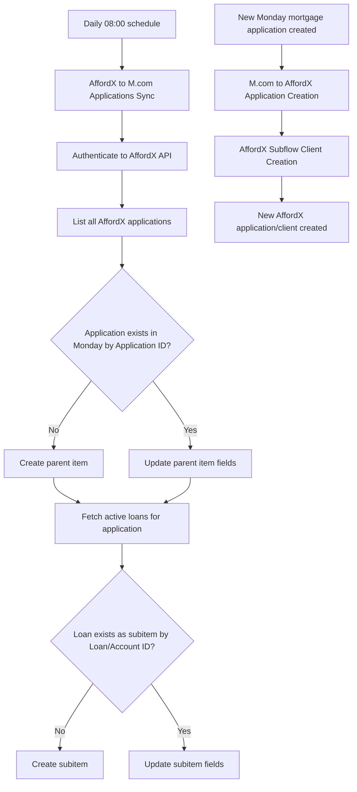

# AUTO-AFFORDX-001 — AffordX Mortgage Application Synchronisation

## 1. Purpose

Keep the AffordX Submissions board in Monday.com synchronised with mortgage applications and their active loans in AffordX (daily pull), and create a new AffordX application when a corresponding Monday mortgage application is created, so advisers get an up-to-date operational view of both systems without manual re-entry.

## 2. Business context

AffordX supports bank-statement analysis, application tracking and meeting summaries/transcriptions and is an `Active - Expanding` system (`knowledge/02_SYSTEMS_REGISTRY.md` SYS-AFFORDX-001). This automation is the two-way bridge between AffordX applications/loans and Monday.com.

## 3. Scope

### Included

- Daily (8am) pull of all AffordX applications into a parent item per application on the AffordX Submissions board, keyed by AffordX Application ID.
- Pull of each application's active loans (Accounts → Loans) as subitems, keyed by Loan/Account ID.
- Upsert logic: create if new, update mapped fields if the record already exists (no duplicates).
- Creation of a new AffordX application from a new Monday mortgage application (`M.com to AffordX Application Creation`), using a reusable client-creation subflow.

### Excluded

- Bank-statement analysis itself, or AffordX's meeting summary/transcription features (separate, undocumented AffordX capabilities per `knowledge/01_RSFA_SYSTEM_MAP.md` §4.4 known gaps).

### Included as of 2026-09-05 — AffordX → Existing Mortgages sync

- The 🏧 AffordX: Bank Statements Monday board (`5025365497`) **is confirmed in scope**, superseding the earlier "not confirmed" note: it is the source board for a second, newer sync direction — see §10a. This corrects the earlier exclusion, which predates this sync's discovery.
- Syncing a loan from an AffordX Bank Statements subitem into the ✅️ Existing Mortgages board (`5024672364`), gated by an explicit adviser-controlled guardrail column (`Existing Mortgages Syncing`).

## 4. Current status

Active. `High` criticality.

**Resolved 2026-09-05 (live):** the previously-missing `Subflow Application Creation Monday-AffordX (Apr 2026)` (`9067654`) has been found — it exists, is Active, `islinked: true` (confirmed called by other scenarios), lives outside any Make folder (not deleted, simply unfiled), and was last edited 2026-08-26. It is a callable subflow that searches Contacts (via `8518416`), creates the AffordX board item and its bank-statement subitems. This closes the previously-open "must be located or confirmed deleted" gap.

**Incident 2026-11-07 → 2026-11-09 — resolved (Confirmed from live system, 2026-11-09):** after RSFA restructured the groups on 🏧 AffordX: Bank Statements (`5025365497`), the old default group (`topics`, labelled "Applications" in the blueprint) no longer existed. Module 5 of `9067654` (`Create Application in Afford X Board`) was still hardcoded to `groupId: topics`, so every new item creation failed with `Group not found (ResourceNotFoundException)` / HTTP 404. Failures occurred on the daily runs of 2026-11-08 and 2026-11-09 NZ time (4 `COMP-MAKE-ERROR-001` emails per run, 67 errors in total per run) and went to the scenario's incomplete-executions queue (DLQ, 66 entries), while the execution list kept showing `SUCCESS`. On 2026-11-09 (UTC) the module was changed to `groupId: group_mm0sphwy` (group **New**), approved by Leo Melman. The next daily run (2026-11-09 19:00 UTC) completed with 34 successful subflow executions, no error emails, and 33 previously-missing applications created in `New` with no duplicate names. The DLQ entries were **not** replayed — see §17.

**New as of 2026-09-05 — AffordX → Existing Mortgages sync (Active - Under Improvement):** a second sync direction, from AffordX loans into Existing Mortgages, was found live and confirmed structurally via blueprint inspection — see §10a. Per RSFA this is complete and in production, with one explicitly open post-production refinement (the Client Profile linkage question, §18).

## 5. Trigger

- `AffordX to M.com Applications Sync (Aug 2025)` (`6238398`): Scheduled, daily at 08:00.
- `M.com to AffordX Application Creation (Jul 2025)` (`6468551`): Monday.com instant trigger (watch) — fires on new mortgage application creation.
- `AffordX Subflow Client Creation (Sep 2025)` (`7292131`): On-demand, called by the parent scenario above (also independently callable as a subscenario).

## 6. Inputs

- AffordX API: Application Summary (Application Date, Applicants/Account Holders, Application Status) and Accounts → Loans (Account/Loan No., Account Holders, Product Name, Repayment Frequency/Amount/Date, Interest Type & Rate, dates, terms).
- Monday.com mortgage application data (for the creation-direction scenario).

## 7. Outputs

- Parent item per AffordX application on the AffordX Submissions board, with subitems per active loan.
- New AffordX application/client created from a new Monday mortgage application.

## 8. Systems involved

AffordX (HTTP/Custom API), Monday.com, Make.com (execution).

## 9. Related Monday boards

| Board | ID | Role |
|---|---|---|
| 🏧 AffordX: Bank Statements | `5025365497` | Destination for the daily AffordX sync (parent item per application). **Confirmed from live blueprint 2026-11-09:** `6238398` searches this board by item name (= AffordX Application ID) and `9067654` creates new items here in group **New** (`group_mm0sphwy`). This is the board earlier documentation called "AffordX Submissions". Current groups (live 2026-11-09): `Waiting For Documents` (`group_mm0sxtzc`, top group), `Documents Received` (`group_mm0s7ksd`), `New` (`group_mm0sphwy`), `Archived` (`group_mm0sx3tq`). |
| Subitems of 🏧 AffordX: Bank Statements | `5025365498` | Loan subitems; searched by `6238398` when comparing loans (confirmed from live blueprint 2026-11-09). |

## 10. Platform implementation

### Make.com scenarios

| Scenario ID | Exact Make name | Role | Status | Trigger | Calls | Called by | Source confidence |
|---|---|---|---|---|---|---|---|
| `6238398` | AffordX to M.com Applications Sync (Aug 2025) | Parent | Active | Scheduled (daily 08:00 NZ local time — runs at 19:00 UTC during NZDT, confirmed live 2026-11-09) | `Outlook: Email Notification after Failed Scenario` (`8732008`); `Subflow Application Creation Monday-AffordX (Apr 2026)` (`9067654`) | None confirmed | Current (live Make, 2026-11-09). The earlier "`9067654` not found" note is obsolete — resolved 2026-09-05 (§4) |
| `9067654` | Subflow Application Creation Monday-AffordX (Apr 2026) | Bridge subflow | Active | On-demand (called by `6238398`) | `M.com: Subflow Search Contacts in Monday (Feb 26)` (`8518416`); `COMP-MAKE-ERROR-001` | `AffordX to M.com Applications Sync (Aug 2025)` (`6238398`) | Confirmed from live blueprint, 2026-11-09. Creates the parent item on `5025365497` (group `New`), downloads bank statements into the file column, creates loan subitems. Last edited 2026-11-09 (group change, §4) |
| `6468551` | M.com to AffordX Application Creation (Jul 2025) | Parent | Active | Monday.com instant trigger (watch) | `Outlook: Email Notification after Failed Scenario` (`8732008`); `AffordX Subflow Client Creation (Sep 2025)` (`7292131`) | None confirmed | Current (registry + call graph) |
| `7292131` | AffordX Subflow Client Creation (Sep 2025) | Parent (also callable as subscenario) | Active | On-demand (called by parent scenario) | `Outlook: Email Notification after Failed Scenario` (`8732008`) | `M.com to AffordX Application Creation (Jul 2025)` (`6468551`) | Current (registry + call graph). **Shared component — document once here, do not create a separate canonical automation ID.** |

`source-material/make/AffordX Applications Sync to Monday.md` describes the daily sync's business logic (parent/subitem upsert by Application ID / Loan ID) in detail and is treated as the primary walkthrough for `6238398`, though the source document does not use Make scenario IDs directly — the mapping to `6238398` is based on the matching daily-8am schedule and identical upsert logic.

### Power Automate flows

Not applicable.

### Monday native automations or workflows

Not applicable, per available evidence.

### Native integrations

Not applicable — this is a Make.com-mediated integration, not a native Monday/AffordX connector.

### Shared subflows and components

`AffordX Subflow Client Creation (Sep 2025)` (`7292131`) — reusable client-creation logic called by `6468551`; also flagged in `knowledge/03_AUTOMATION_REGISTRY.md` §8 as a component to document inside this automation rather than as its own canonical ID.

`COMP-MAKE-ERROR-001` — called by all three scenarios in this family.

## 10a. AffordX → Existing Mortgages sync (new, confirmed live 2026-09-05)

**Status: Active - Under Improvement (Confirmed from live system, 2026-09-05).** Documented separately from the daily AffordX Submissions sync above because it runs on a different Monday board pair, a different scenario chain, and was found live only during this update pass — RSFA's own account of this feature (per the update request that prompted this documentation) matches the structure found in the live Make blueprints.

**Business behaviour (Confirmed from live Make + Monday schema, 2026-09-05):** an adviser explicitly marks a loan subitem on the 🏧 AffordX: Bank Statements board (`5025365497`) as `Existing Mortgages Syncing` = **Sync** (subitem status column; other values are `Don't Sync` and `Pending Decision`). This is the guardrail: only the loan explicitly marked `Sync` drives the sync, which is how RSFA avoids the problem of multiple AffordX applications sharing the same Loan Number. The sync then:

1. Looks up the loan's Loan Number in ✅️ Existing Mortgages (`5024672364`).
2. If a matching Existing Mortgages record is found (and exactly one match) → updates it and its subitem sync relation. If **more than one** match is found, the flow takes an explicit error branch instead of guessing (`COMP-MAKE-ERROR-001` notification) — a safety property confirmed directly from the blueprint's routing logic, not inferred.
3. If no match is found → creates a new Existing Mortgages record. New mortgages created this way are marked `AffordX Status` = **Rod to Check** (confirmed live Monday status label).
4. Either branch ends with a Slack notification (`Send Uploaded Notification To Slack`, confirmed live) and a board_relation update on the AffordX subitem (`Item Sync In Existing Mortgages`).
5. Once a loan is selected for `Sync`, subsequent edits to that AffordX subitem continue to flow through this same path (re-running the parent scenario re-triggers the same update/create logic) — confirmed by the parent scenario's webhook-driven, re-entrant design; not separately load-tested in this pass.

### Scenario chain (Confirmed from live blueprint inspection, 2026-09-05)

| Scenario ID | Exact Make name | Role | Trigger | Notes |
|---|---|---|---|---|
| `9721689` | M.com: AffordX item Need Sync to Existing Mortgages (Aug 2026) | Parent | Webhook (custom webhook, "Lead"-style item-level trigger from the AffordX subitem) | Fetches the AffordX subitem, its parent, Contact and Client Profile, calls `9662353`, then updates the AffordX subitem's `Item Sync In Existing Mortgages` relation. Created 2026-08-27, last edited 2026-09-04. |
| `9662353` | M.com: Subflow AffordX to Existing Mortgages Sync (Aug 2026) | Bridge subflow (also independently callable) | On-demand | Does the actual Existing Mortgages search/create/update described above. Calls `8518416` (Search Contacts) to resolve the Contact. Created 2026-08-14, last edited 2026-09-05 (same day as this documentation pass — actively worked on). |

Both scenarios call `COMP-MAKE-ERROR-001` on every module's error branch, consistent with the rest of this family.

### Field mapping (Confirmed from live Make scenario interface + live Monday column schema, 2026-09-05)

| Make subflow input (`9662353` interface) | Existing Mortgages column (confirmed live) | Notes |
|---|---|---|
| `LoanNumber` | `Loan Number` (text) | De-duplication key |
| `TermYears` | `Doc Term` (numbers, "year" unit) | User's "Doc Term" mapping confirmed |
| `FRexp` | `FR Exp` (date) | — |
| `InterestRate` | `Interest Rate` (numbers, %) | — |
| `IOExp` | `IO Exp` (date) | — |
| `OriginalLoan` | `Original Loan ($)` (numbers) | — |
| `PIorIO` | `P&I or IO` (status: P&I / IO) | — |
| `Repeyment` (sic — literal Make interface field name) | `Repayment` (numbers) | Typo exists in the live Make interface, not in the Monday column name |
| `SettelmentDate` (sic — literal Make interface field name) | `Settlement Date` (date) | Typo exists in the live Make interface, not in the Monday column name |
| `Frequency` | `Frequency` (status: Monthly/Fortnightly/Quarterly/Weekly) | — |
| `LoanType` | `Loan Type` (status: Fixed/Floating/Offset/RC/Construction loan) | — |
| `ClientSummary`, `PeoplesIDS`, `ApplicationID`, `SubitemID` | Used internally for Contact/Client Profile/subitem resolution | Not directly mapped to a single Existing Mortgages column |

### Open item — NOT resolved (per RSFA, raised 2026-09-04)

RSFA raised an open question on 2026-09-04 about exactly which Client Profile the AffordX ↔ Existing Mortgages links should point to (a Contact can, in principle, relate to more than one Client Profile, and the AffordX board's `Client Profile` column is a mirror derived through Contacts rather than a direct relation). **This is explicitly an open post-production refinement, not resolved** — do not treat the Client Profile linkage as fully verified. TODO: verify directly with RSFA before relying on this relation for anything Client-Profile-specific.

## 11. End-to-end process

## 12. Data mapping

| AffordX field (Application Summary) | Monday parent item column | Notes |
|---|---|---|
| Application ID | De-duplication key | Used to decide create vs. update |
| Application Date | Application Date | — |
| Applicants / Account Holders | Applicants / Account Holders (Text) | Planned enhancement: link to Contacts board (not yet implemented per source material) |
| Application Status | Application Status | — |

| AffordX field (Accounts → Loans) | Monday subitem column | Notes |
|---|---|---|
| Loan/Account ID | De-duplication key | Used to decide create vs. update |
| Account Holders | Account Holders | — |
| Product Name | Product Name | — |
| Repayment Frequency / Next Amount / Next Date | Repayment Frequency / Repayment Next Amount / Repayment Next Date | — |
| Interest Type & Rate, Interest Expiry Date, Is Interest Only, Interest Only Expiry Date | Corresponding interest columns | — |
| Original Drawdown Date, Initial Principal, Total Year Term, Remaining Time, Maturity Date | Corresponding loan-term columns | — |

## 13. Decision and routing logic

- Parent items are keyed by AffordX Application ID; subitems by Loan/Account ID.
- **Confirmed from live blueprint of `6238398` (2026-11-09):** the daily run lists *all* applications for each configured AffordX agent account (not only new ones) and, per application, searches `5025365497` for an item whose name equals the Application ID:
  - Not found (and the application has at least one client email) → calls `9067654` to create it. This makes the daily run self-healing: an application whose creation failed is retried on the next run.
  - Found and status is not `Archived`/`Completed` → compares the application and its loans. If the parent data changed ("Change In Father") or the number of loan subitems differs ("More or Less Subitems"), the existing item is **deleted and recreated** through `9067654`; otherwise subitems are updated/created individually.
- The earlier description of "strict upsert, never duplicate-create" is therefore only partly accurate: creation is guarded by the name search in the parent, but `9067654` itself does not check for an existing item before creating one.
- Only **active** loans are pulled as subitems (closed-loan handling is a stated roadmap item, not yet implemented per source material).

## 14. Dependencies

- `9067654` (`Subflow Application Creation Monday-AffordX`) is confirmed to exist and be Active — no longer an open dependency gap (resolved 2026-09-05).
- AffordX API credentials and Monday API token, stored in Make's connection vault.
- Board/column IDs stored as Make scenario variables — must be updated if the board is cloned or fields renamed (explicit warning in source material).
- **Group ID dependency (confirmed 2026-11-09):** module 5 of `9067654` creates items in group `New` (`group_mm0sphwy`) on `5025365497`. Deleting or replacing that group breaks every new-item creation (see the 2026-11-07 → 2026-11-09 incident in §4). Any restructuring of the board's groups must be checked against this module first.
- The AffordX → Existing Mortgages sync (§10a) depends on the adviser explicitly setting `Existing Mortgages Syncing` = `Sync` on exactly one AffordX subitem per Loan Number; the guardrail assumes advisers follow this convention.

## 15. Error handling

All scenarios in this family call `COMP-MAKE-ERROR-001` on failure.

**Observed behaviour (confirmed 2026-11-09):** module errors in `9067654` are routed to the scenario's incomplete-executions queue (DLQ) and reported by `COMP-MAKE-ERROR-001` emails ("Encountered N errors in Subflow Application Creation Monday-AffordX…", sent to Rod and forwarded to the `tech@` mailbox). The execution list still reports those runs as `SUCCESS`, so filtering executions by failed/warning status does not reveal them — check the error emails and the DLQ count instead.

## 16. Logging and observability

No dedicated log board confirmed. "Last Synced At" is listed as an optional audit column on the Monday parent item in source material — TODO: verify whether this column is actually implemented.

## 17. Manual operations and reprocessing

Not confirmed. TODO: verify whether the daily sync can be manually re-run on demand (e.g. after fixing a mapping issue) without waiting for the next 08:00 schedule.

**Reprocessing after a creation failure (2026-11-09 guidance, based on live blueprint):** fix the cause and let the next daily run recreate the missing items (§13). Do **not** replay the `9067654` DLQ entries after a successful daily run: the subflow creates items without checking whether they already exist, so a replay would create duplicates. Clearing the stale DLQ entries is a write action in Make and requires explicit approval. As of 2026-11-09 the 66 DLQ entries from the incident in §4 had not been replayed or cleared.

## 18. Known limitations

- Applicants are currently stored as plain text on the Monday parent item, not yet linked to the Contacts board (explicitly flagged as a planned enhancement in source material, not yet implemented).
- Closed/inactive AffordX loans are not currently archived or flagged in Monday — also a stated roadmap item, not yet implemented.
- When an application's data or loan count changes, the parent item is deleted and recreated (§13): any manual edits on that Monday item are lost, and links are rebuilt only by the automation.
- No Slack notification for new applications or status changes currently exists on the daily-sync side (§5–13 above); the newer Existing Mortgages sync (§10a) does have Slack notifications, confirmed live.
- **Open, not resolved (raised by RSFA 2026-09-04):** which Client Profile the AffordX ↔ Existing Mortgages links should point to when a Contact relates to more than one Client Profile — see §10a. Do not mark this as resolved without further evidence.
- The "more than 1 match" error branch in §10a's Loan Number search has not been deliberately tested against a real duplicate-Loan-Number scenario; its behaviour is confirmed from the blueprint's routing logic, not from an observed execution.

## 19. Security and sensitive data

AffordX application and loan data includes detailed client financial information (loan amounts, repayment schedules, interest rates). Never use real client loan data as test data; use fictional test applications and loans only.

## 20. Testing

### Confirmed tests

| Date | Test | Result | Evidence |
|---|---|---|---|
| 2026-11-09 | New-item creation after changing `9067654` module 5 group to `New` (`group_mm0sphwy`) — production daily run | Passed | Daily run 2026-11-09 19:00 UTC: 34 `9067654` executions `SUCCESS`; no error emails; 33 applications created in group `New`; board count 123 → 156; no duplicate item names found |
| 2026-11-09 | Existing-item updates on the same run | Partially verified | Inferred from successful executions and board update timestamps; individual update paths were not inspected |

### Required regression tests

- New AffordX application not yet in Monday → parent item created.
- Existing AffordX application with changed status → parent item updated, not duplicated.
- New active loan under an existing application → subitem created.
- Existing loan with changed repayment details → subitem updated, not duplicated.
- New Monday mortgage application → AffordX application/client created via the subflow.

### Test data restrictions

Use fictional applications, loans and client names only; never sync real client loan data into a test board.

## 21. Validation after change

Run the daily sync (or trigger manually if possible) against a test AffordX application, confirm the parent item and its loan subitems appear/update correctly in Monday without duplication. For the creation direction, create a test Monday mortgage application and confirm a corresponding AffordX application/client is created.

## 22. Rollback

Disable the affected Make.com scenario(s). No automated rollback of already-synced Monday items or already-created AffordX applications is defined.

For the 2026-11-09 group change: the previous value was `groupId: topics` (label "Applications"). Reverting it would reintroduce the `Group not found` error because that group no longer exists; to change the destination, point module 5 to another existing group ID instead.

## 23. Troubleshooting guide

1. Confirm the daily schedule actually ran (check Make.com scenario run history for `6238398`).
2. Confirm AffordX API authentication succeeded.
3. If a specific application/loan is missing or stale in Monday, check its Application ID / Loan ID against the AffordX source record.
4. For the creation direction, confirm the new Monday mortgage application actually triggered scenario `6468551`, and check whether `AffordX Subflow Client Creation` completed successfully.
5. Check for `COMP-MAKE-ERROR-001` failure emails and the `9067654` DLQ count — runs can show `SUCCESS` while errors are queued (§15).
5a. `Group not found (ResourceNotFoundException)` on `create_item` means the group hardcoded in `9067654` module 5 no longer exists on `5025365497`; compare it with the board's current groups (§9).
6. If a mapping issue is suspected, check the Make scenario variables for board/column IDs — these must be updated if the board is cloned or fields renamed.

## 24. Source references

- `source-material/make/AffordX Applications Sync to Monday.md` — Current. Detailed daily-sync business logic, data model and roadmap notes.
- `exports/make/valid-scenarios-working-inventory.md`, `exports/make/make-scenario-call-graph.md` — Current. Scenario IDs, trigger types, the confirmed missing-subscenario gap.
- `knowledge/03_AUTOMATION_REGISTRY.md` §3, §4, §8, §10 — Current. Canonical ID, family grouping, shared-component treatment of the client-creation subflow, and the explicit missing-scenario gap.
- `knowledge/02_SYSTEMS_REGISTRY.md` SYS-AFFORDX-001 — Current. Platform description and status.
- Live Make MCP blueprint inspection, 2026-09-05 — scenarios `9067654`, `9721689`, `9662353`. Confirmed from live system.
- Live Monday MCP `get_board_info`, 2026-09-05 — boards `5024672364` (Existing Mortgages) and `5025365497` (AffordX: Bank Statements). Confirmed from live system.
- Live Make API blueprint inspection of `9067654` and `6238398`, Make execution lists, `tech@` mailbox error emails and Monday board `5025365497` items/groups, 2026-11-09. Confirmed from live system.
- Slack `#leo_it_tasks` thread reporting the incident: https://rsfa-realadvice.slack.com/archives/C0895LK722Z/p1794087035794109

## 25. Known gaps

- ~~Exact current Monday board ID for "AffordX Submissions" is not confirmed.~~ **Resolved 2026-11-09** (live blueprint): the daily sync writes to `🏧 AffordX: Bank Statements` (`5025365497`).
- 66 stale DLQ entries on `9067654` from the 2026-11-07 → 2026-11-09 incident — not replayed (would duplicate); clearing them pending approval.
- Roadmap items (Contacts linkage, closed-loan handling, Slack notifications on the daily-sync side) are explicitly not yet implemented — do not describe them as current behaviour.
- **Open (§10a, §18):** which Client Profile the AffordX ↔ Existing Mortgages sync should point to when a Contact has more than one Client Profile — raised by RSFA 2026-09-04, not resolved.
- The AffordX subitem "more than 1 match" error branch (§10a) has not been observed in a real execution.

## 26. Change history

| Date | Change | Author |
|---|---|---|
| 2026-07-30 | Initial canonical documentation created from registry, call-graph and source-material evidence; missing-scenario gap and unconfirmed board ID recorded. | Claude (documentation task) |
| 2026-09-05 | Live re-verification via Make MCP: resolved the `9067654` missing-scenario gap (found, Active, unfiled); discovered and documented the new AffordX → Existing Mortgages sync (`9721689` parent + `9662353` bridge subflow), confirmed via live blueprint inspection and live Monday column schema for `5024672364` and `5025365497`; recorded the open, unresolved Client Profile linkage question raised by RSFA on 2026-09-04. | Claude (documentation task) |
| 2026-11-09 | Recorded the 2026-11-07 → 2026-11-09 `Group not found` incident and its fix (`9067654` module 5 now creates items in group `New`, `group_mm0sphwy`); documented the verified post-fix run; resolved the "AffordX Submissions" board-ID gap (`5025365497`); corrected the §10 table and §13 routing logic from live blueprints of `6238398`/`9067654` (name-based search, delete-and-recreate branches, self-healing daily retry, no existence check in the subflow); added DLQ/reprocessing guidance, the group-ID dependency, troubleshooting and confirmed tests. | Claude (with Leo Melman) |
