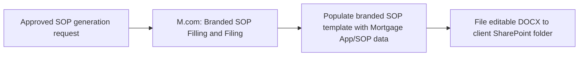

# AUTO-BRANDED-SOP-001 — Branded Mortgage SOP Generation

## 1. Purpose

Generate a branded, editable Statement of Position (SOP) Word document from approved Mortgage App/SOP data and file it into the client's SharePoint folder, so advisers receive a ready-to-use, correctly-branded SOP without manual document assembly.

## 2. Business context

`knowledge/01_RSFA_SYSTEM_MAP.md` §19 lists "Branded Mortgage SOP Generation" as an initial documentation priority (#5), and `✍ Mortgage App/SOP` explicitly supports SOP generation per `knowledge/04_MONDAY_BOARDS_REGISTRY.md`'s operational notes for that board.

**Per RSFA (2026-09-05, Confirmed from provided evidence — not independently verified against the scenario's own blueprint in this pass):** this automation is now **completed and in production**, replacing the previous manual process built around the SuperForm PDF output and Plano (see `knowledge/02_SYSTEMS_REGISTRY.md` SYS-PLANOLITIX-001). It was tested during UAT with real client SOPs before being approved and moved to production; per `CLAUDE.md` §13, real client names/data from that UAT are historical evidence and are deliberately **not** reproduced here.

## 3. Scope

### Included

- Populating a branded SOP Word template from Mortgage App/SOP data via Docx Templater.
- An adviser review step before generation: advisers can review, edit, add or remove line items before activating SOP creation (Confirmed from provided evidence, 2026-09-05 — not yet independently confirmed in the scenario's own blueprint).
- Filing the generated, editable SOP document automatically to the client's SharePoint folder, in the **Mortgages** subfolder (Confirmed from provided evidence, 2026-09-05).
- A Slack notification on completion, containing a link to the generated client document (Confirmed from provided evidence, 2026-09-05; exact Slack channel not independently re-verified this pass, per RSFA it was confirmed correct during UAT).
- Consuming the Mortgage App/SOP board's newer fields where relevant to SOP content: `Amount Current Rent`/`Current Rent Frequency`, the Applicant's Intention question, and the restructured per-property/Postal Address data — see `knowledge/04_MONDAY_BOARDS_REGISTRY.md` §7 for the underlying board fields (Confirmed live via Monday schema, 2026-09-05; the field-to-SOP-section mapping itself is not independently confirmed — see §12).

### Excluded

- The initial Mortgage App/SOP Super Form submission and PDF filing (`AUTO-FORMS-001`).
- Mortgage Application → Masterboard consolidation (`AUTO-MASTERBOARD-001`).
- `M.com: Review Broken SP Links on CP Board (May 2026)` (`9277255`) — an **inactive** maintenance scenario in the same "SharePoint and Documents" functional area per `knowledge/03_AUTOMATION_REGISTRY.md` §4, but not part of SOP generation itself; not documented as part of this automation.

## 4. Current status

**Completed and in production**, per RSFA (2026-09-05). `High` criticality per `knowledge/03_AUTOMATION_REGISTRY.md` §3. Confirmed from the live system (2026-09-05): the scenario `M.com: Branded SOP Filling and Filing (Jul 2026)` (`9555578`) is Active in the `Valid scenarios/working` folder, last edited 2026-08-08 — consistent with, though not itself proof of, the described production changes. The detailed field-level template mapping and trigger condition remain unconfirmed against the scenario's own blueprint (not inspected this pass) — see §12, §13.

## 5. Trigger

`M.com: Branded SOP Filling and Filing (Jul 2026)` (`9555578`): Webhook (custom webhook) — fired by an approved SOP generation request (exact triggering condition/source of the webhook call not confirmed — TODO: verify).

## 6. Inputs

Mortgage App/SOP data for the relevant Monday item; a branded SOP Word template (source and exact storage location not confirmed — TODO: verify, likely SharePoint per the pattern used by `AUTO-AIRCALL-001`'s templates).

## 7. Outputs

A branded, editable SOP DOCX document filed automatically to the client's SharePoint folder, in the **Mortgages** subfolder (per RSFA, 2026-09-05). A Slack notification is sent on completion with a link to the generated document (per RSFA, 2026-09-05).

## 8. Systems involved

Monday.com (data source), Make.com (execution), Docx Templater (document population), Microsoft SharePoint (destination).

## 9. Related Monday boards

| Board | ID | Role |
|---|---|---|
| ✍ Mortgage App/SOP | `5025483251` | Data source for SOP generation |

## 10. Platform implementation

### Make.com scenarios

| Scenario ID | Exact Make name | Role | Status | Trigger | Calls | Called by | Source confidence |
|---|---|---|---|---|---|---|---|
| `9555578` | M.com: Branded SOP Filling and Filing (Jul 2026) | Standalone | Active | Webhook (custom webhook) | None confirmed | None confirmed | Current (registry + call graph); no dedicated source-material walkthrough |

No `source-material/make/` file exists for this scenario — all implementation detail beyond name/trigger/status/systems is inferred from the registry and call-graph exports only.

### Power Automate flows

Not applicable.

### Monday native automations or workflows

Not applicable, per available evidence.

### Native integrations

Not applicable.

### Shared subflows and components

None confirmed for this scenario in the current call-graph export (no call to `COMP-MAKE-ERROR-001` recorded, unlike most other Make family members — TODO: verify this is not simply an unresolved edge in the call graph).

## 11. End-to-end process

## 12. Data mapping

TODO: complete mapping from current production configuration. No field-level template mapping is confirmed from available evidence. Confirmed live (2026-09-05) that the source board (`5025483251`) now carries `Amount Current Rent`/`Current Rent Frequency` (Household Expenses), an Applicant's Intention question, an expanded Purchase Property field set, and a restructured Postal Address / per-property field set (see `knowledge/04_MONDAY_BOARDS_REGISTRY.md` §7) — but which of these actually populate the generated SOP template, and how, is not confirmed.

## 13. Decision and routing logic

Per RSFA (2026-09-05): the adviser reviews, and can edit, add or remove, line items before activating SOP creation — this manual review step is the actual "approval" gate for triggering generation. This has not been independently confirmed in the scenario's own blueprint (not inspected this pass) — TODO: verify the exact webhook trigger and how it relates to a Monday status/button column. Per-adviser or per-brand template selection logic (as seen in the renewal-email automations) is not confirmed either way.

## 14. Dependencies

Depends on the client's SharePoint folder already existing (`AUTO-SP-FOLDER-001`) and on Mortgage App/SOP data being sufficiently complete.

## 15. Error handling

Not confirmed for this scenario specifically — see §10 note on the absence of a confirmed `COMP-MAKE-ERROR-001` call.

## 16. Logging and observability

Not confirmed. TODO: verify.

## 17. Manual operations and reprocessing

Not confirmed. TODO: verify whether a SOP can be manually regenerated on demand.

## 18. Known limitations

This automation's blueprint-level evidence base remains thin: no source-material walkthrough exists, and the call graph does not confirm an error-handling call, which is unusual relative to its sibling scenarios — this was not re-checked in this pass (§9555578's blueprint was not inspected 2026-09-05, only its active/last-edited status). The production-status and behavioural facts in §3/§4/§7/§13 come from RSFA's own account of the completed work, not from a live blueprint inspection — treat them as "Confirmed from provided evidence", not "Confirmed from live system", until the scenario itself is inspected.

## 19. Security and sensitive data

Generated SOP documents contain client financial and personal mortgage-application data. Never generate a real client's SOP as test data; use a dedicated fictional test Mortgage App/SOP item. Per `CLAUDE.md` §13, the real-client SOPs used during this automation's UAT are historical evidence only and must not be reproduced (client names, financial detail, etc.) anywhere in this repository.

## 20. Testing

### Confirmed tests

Per RSFA (2026-09-05): tested during UAT with real client Mortgage App/SOP items before being approved and moved to production. This is historical/UAT evidence, not reproduced here with client detail per `CLAUDE.md` §13, and has not been independently re-verified against a live scenario run in this pass.

### Required regression tests

- Approved test Mortgage App/SOP item → correctly-populated branded SOP generated and filed.
- Missing required source field → confirm behaviour (fails gracefully vs. generates an incomplete document) — TODO: verify expected behaviour before writing this test.

### Test data restrictions

Use a dedicated fictional test Mortgage App/SOP item only.

## 21. Validation after change

Trigger SOP generation for a test item, confirm the resulting DOCX is correctly branded, contains the expected test data, and is filed to the expected test SharePoint location.

## 22. Rollback

Disable the `M.com: Branded SOP Filling and Filing (Jul 2026)` scenario. No automated rollback of already-generated documents is defined.

## 23. Troubleshooting guide

1. Confirm the webhook that triggers this scenario actually fired (check the source system that calls the webhook, once confirmed).
2. Confirm the Mortgage App/SOP item has the data fields the template expects.
3. Confirm the client's SharePoint folder exists and is reachable.
4. Check Make.com scenario run history for this scenario directly, since no shared error-handler call is currently confirmed.

## 24. Source references

- `exports/make/valid-scenarios-working-inventory.md`, `exports/make/make-scenario-call-graph.md` — Current. Scenario ID, trigger type, systems, status.
- `knowledge/03_AUTOMATION_REGISTRY.md` §3, §4 — Current. Canonical ID, family grouping, documentation priority.
- `knowledge/01_RSFA_SYSTEM_MAP.md` §19 — Current. Documentation priority listing.
- `knowledge/04_MONDAY_BOARDS_REGISTRY.md` — Current. Mortgage App/SOP board's SOP-generation note.
- No `source-material/make/` file exists for this scenario.
- RSFA direct report, 2026-09-05 — reported: production status, adviser line-item review/edit step before generation, automatic filing to the client's SharePoint Mortgages subfolder, Slack completion notification with document link, and successful UAT with real clients prior to production approval. Historical/RSFA-reported, not independently verified against the scenario's own blueprint — see §18.
- Live Make MCP scenario metadata, 2026-09-05 — scenario `9555578` confirmed Active, last edited 2026-08-08.
- Live Monday MCP `get_board_info`, 2026-09-05 — board `5025483251` (Mortgage App/SOP), confirming the new Current Rent / Applicant's Intention / Purchase Property / Postal Address columns referenced in §3.

## 25. Known gaps

- No implementation walkthrough exists; exact trigger source, template location, and error-handling behaviour are all unconfirmed against the scenario's own blueprint.
- Relationship (if any) to the inactive `M.com: Review Broken SP Links on CP Board (May 2026)` scenario in the same functional area is not established.
- The exact mapping from the Mortgage App/SOP board's new fields (Current Rent, Applicant's Intention, per-property Postal Address) to specific sections of the generated SOP document is not confirmed — only that these fields exist on the source board.
- The Slack channel used for the completion notification has not been independently re-verified this pass (per RSFA it was confirmed correct during UAT).

## 26. Change history

| Date | Change | Author |
|---|---|---|
| 2026-07-30 | Initial canonical documentation created from registry and call-graph evidence only; no source-material walkthrough available. | Claude (documentation task) |
| 2026-09-05 | Documented, per RSFA's direct report, that this automation is completed and in production: adviser line-item review/edit step, automatic filing to the client's SharePoint Mortgages subfolder, Slack completion notification, and successful real-client UAT prior to production approval (UAT client detail deliberately not reproduced). Cross-checked scenario `9555578`'s live Active status and the Mortgage App/SOP board's new fields via Monday MCP; did not re-inspect the scenario's own blueprint this pass. | Claude (documentation task) |
