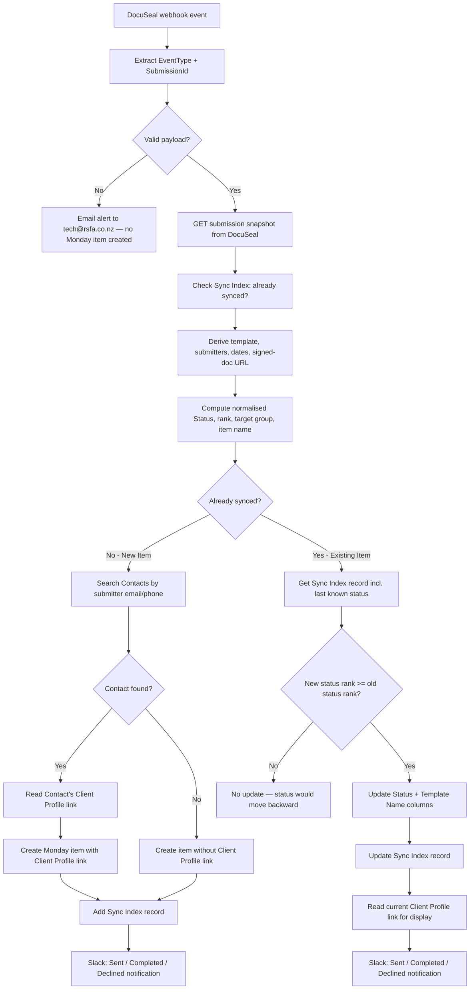

# AUTO-DOCUSEAL-001 — DocuSeal Submission Lifecycle Sync

## 1. Purpose

Create and maintain one Monday.com item per DocuSeal e-signature submission on the `🖊️ DocuSeal Submissions (WIP)` board, keeping its status, dates and signed-document link current as the submission moves through its lifecycle, linking it to the correct Contact/Client Profile where one can be found, and notifying the team in Slack at key milestones (sent, completed, declined) — without anyone needing to check DocuSeal directly.

## 2. Business context

Per RSFA (reported directly, 2026-09-20, not yet independently verified live beyond the evidence in §24): RSFA is planning to migrate from DocuSign to DocuSeal for client document signing, expected to happen between October and November 2026. Once that migration completes, the current DocuSign Power Automate automation (`AUTO-DOCUSIGN-001`) is expected to stop being used. This scenario is the first production automation built for DocuSeal and is the technical foundation that migration depends on — see `knowledge/decisions/ADR-002-docusign-to-docuseal-migration.md`.

DocuSeal itself was previously listed as `Experimental` / `Low` criticality in `knowledge/02_SYSTEMS_REGISTRY.md` (SYS-DOCUSEAL-001), with only a test board and trial account. This scenario is evidence that DocuSeal has moved past pure experimentation — see §19 for what is and is not confirmed as production-ready.

## 3. Scope

### Included

- Receiving DocuSeal webhook events (`submission.created`, `form.started`, `form.viewed`, `form.completed`, `form.declined`, `submission.completed`, `submission.expired`) and fetching the full submission snapshot from the DocuSeal API.
- Deriving a normalised status (`Draft`, `Sent`, `Viewed`, `Completed`, `Declined`, `Expired`) from the event type and the submission's own status/submitter data.
- Creating a new Monday item on first sight of a submission, attempting to match a submitter's email/phone to a Contact and, through the Contact, to a Client Profile.
- Updating an existing item's status, template name, completion date and signed-document link on later events, guarded so status can only move forward, never backward.
- Sending Slack notifications for Sent, Completed and Declined milestones, and separate technical-failure alerts (email always, Slack for some steps — see §15) to the tech team.
- A per-submission Make Data Store record (`DocuSeal Sync Index (Sep 2026)`, datastore `185679`) used to detect whether a submission has already been synced and to avoid re-sending the same milestone notification.

### Excluded

- Sending or configuring the DocuSeal submission itself (this scenario only reacts to submissions that already exist in DocuSeal).
- Any DocuSign-side processing — this is a separate, parallel automation, not a replacement wired into `AUTO-DOCUSIGN-001` yet.
- Filing the signed document into SharePoint (the signed-document link is written to Monday as a URL column; no download/upload step is present in this scenario, unlike `AUTO-DOCUSIGN-001`'s SharePoint filing).

## 4. Current status

Active. Confirmed from the blueprint export provided directly by RSFA on 2026-09-20 (`exports/make/blueprints/9803640-docuseal-submission-lifecycle-sync.blueprint.json`) and corroborated by a Slack screenshot from the scenario's own Make Bot notifications, showing one real end-to-end run (Sent → Completed) for a test submission ("Sample Document" template, test recipient `leomelmanvp@gmail.com`, Client Profile "Leo The Lion & Leo Testing"). Not independently re-verified via the Make MCP connector or live DocuSeal/Monday queries in this session — see §19 for the test-data implication and §24 for exact evidence.

`High` criticality assigned here because this scenario is the intended production backbone for all future client e-signature tracking once the DocuSign migration completes (per RSFA, §2), even though today's usage is still early/limited.

## 5. Trigger

Instant webhook (`gateway:CustomWebHook`, webhook id `4371210`, module "Webhook: Receive DocuSeal Event") — fires on every DocuSeal webhook delivery. The routing logic (§13) recognises these `event_type` values: `submission.created`, `form.started`, `form.viewed`, `form.completed`, `form.declined`, `submission.completed`, `submission.expired`. Any other event type falls through to a default branch that derives status directly from the fetched submission body (§13).

## 6. Inputs

- DocuSeal webhook payload: `event_type`, and a submission identifier read with a three-way fallback (`data.submission_id`, then `data.submission.id`, then `data.id`).
- DocuSeal API response for `GET /submissions/{id}` (module 10, connection `14378638`, via the `docuseal:universal` module — a generic/custom connector, not an official native Make app for DocuSeal): `status`, `completed_at`, `combined_document_url`, `template.name`, `created_by_user.email`, and the `submitters[]` array (`name`, `email`, `phone`, `status`, `sent_at`, `decline_reason`, `role`, `id`).
- Make Data Store `DocuSeal Sync Index (Sep 2026)` (`185679`), keyed `docuseal_submission:{SubmissionId}`, holding `MondayItemId`, `LastKnownStatus`, `LastEventTimestamp`, `NotifiedSent`, `NotifiedCompleted`, `NotifiedDeclinedSubmitterIds`, `NotifiedNeedsReview`, `LockTimestamp`.
- Monday Contacts board (`2074688484`), searched by submitter email/phone via the shared subflow `M.com: Subflow Search Contacts in Monday (Feb 26)` (`8518416`).
- The matched Contact's own `board_relation_mkxpzyfq` column (its Client Profile link) — used to pre-fill the new DocuSeal Submission item's Client Profiles column.

## 7. Outputs

- A new or updated item on `🖊️ DocuSeal Submissions (WIP)` (`5029524384`), placed in one of three groups by status (`group_mm4qa1h0` for Draft/Sent/Viewed, `group_mm4q8vrz` for Completed, `group_mm4q1z3r` for Declined/Expired).
- An updated `DocuSeal Sync Index (Sep 2026)` Data Store record for the submission.
- Slack messages to an operational channel (`C07R2JNE0J0`) for Sent/Completed/Declined milestones, and to a technical channel (`C0BDU8F52S0`) for a subset of technical failures (§15).
- Technical-failure emails to `tech@rsfa.co.nz` via `COMP-MAKE-ERROR-001` (subscenario `8732008`) on any step failure, including on a malformed/invalid webhook payload.

## 8. Systems involved

DocuSeal (source, reached through a generic/"universal" Make HTTP connector rather than an official native app module — worth remembering if DocuSeal's API changes, since this connector has no vendor-maintained schema), Make.com (execution, connection `14378638` for DocuSeal, `240128` for Monday, `4778199` for Slack), Monday.com (`🖊️ DocuSeal Submissions (WIP)` destination board, `Contacts` board for matching, `Client Profiles` board reached only indirectly through the Contact's relation column), Slack (two channels, IDs only — see §18), Microsoft Outlook (technical alert emails via `COMP-MAKE-ERROR-001`).

## 9. Related Monday boards

| Board | ID | Role |
|---|---|---|
| 🖊️ DocuSeal Submissions (WIP) | `5029524384` | Destination board; one item per DocuSeal submission |
| Contacts | `2074688484` | Searched by submitter email/phone to resolve a Contact, and read for its Client Profile relation column |
| Client Profiles | `5024661649` | Reached indirectly, only through the matched Contact's `board_relation_mkxpzyfq` column; never queried directly by this scenario |

Per `knowledge/04_MONDAY_BOARDS_REGISTRY.md` (prior to this update), `🖊️ DocuSeal Submissions (WIP)` was classified `Experimental` / `Low` criticality with the purpose "Experimental board for a potential DocuSeal implementation." That classification is now out of date given this scenario actively writes to it — see the registry update accompanying this document.

## 10. Platform implementation

### Make.com scenarios

| Scenario ID | Exact Make name | Role | Status | Trigger | Calls | Called by | Source confidence |
|---|---|---|---|---|---|---|---|
| `9803640` | M.com: DocuSeal Submission Lifecycle Sync (Sep 2026) | Parent | Active | Webhook (custom webhook, instant) | `8518416` (contact search), `8732008` (error email) | None confirmed | Current — read directly from the RSFA-supplied blueprint export, 2026-09-20 |
| `8518416` | M.com: Subflow Search Contacts in Monday (Feb 26) | Shared component | Active | On-demand (subscenario) | — | Confirmed callers per `knowledge/03_AUTOMATION_REGISTRY.md` §8 plus this scenario (new caller, not yet added there) | Current |
| `8732008` | Outlook: Email Notification after Failed Scenario | Shared component (`COMP-MAKE-ERROR-001`) | Active | On-demand (subscenario) | — | Called by nearly every `onerror` branch in this scenario (§15) | Current |

### Power Automate flows

Not applicable.

### Monday native automations or workflows

Not applicable, per available evidence.

### Native integrations

Not applicable — DocuSeal integrates via a Make.com webhook and a custom/universal HTTP connector, not a native Monday connector.

### Shared subflows and components

- `COMP-MAKE-ERROR-001` (`8732008`) — called by the invalid-payload branch and by nearly every step's `onerror` handler.
- `M.com: Subflow Search Contacts in Monday (Feb 26)` (`8518416`) — called once per new (not-yet-synced) submission to resolve a Contact from submitter email/phone.

## 11. End-to-end process

## 12. Data mapping

| DocuSeal / derived field | Monday column (ID) | Written | Notes |
|---|---|---|---|
| `TemplateShort` + `RecipientLabel` + `SentDateFormatted` | `name` | Create only | e.g. "Sample Document - Leo The Lion - 15 September 2026" |
| Resolved Client Profile (via Contact) | `board_relation_mm4qrrxr` (Client Profiles) | Create only (new item, contact-found branch) | Never re-linked or corrected on later events; a no-contact-found item is never retroactively linked |
| First submitter's email | `email_mm4qvnap` (Primary Submitter Email) | Create only | |
| `EarliestSentAt` | `date_mm4q429w` (Sent At) | Create only | |
| `CompletedAt` | `date_mm4qbe7` (Completed At) | On Completed with a completion date present | Written by two overlapping branches — see §18 |
| Normalised `NewStatus` | `color_mm4qhhhc` (Status) | Create, and on every later event (forward-only guard, §13) | |
| DocuSeal `template.name` | `text_mm4qr449` (Template Name) | Create, and re-written on every later existing-item update | |
| DocuSeal submission ID | `text_mm4qr3yv` (DocuSeal Submission ID) | Create only | |
| `SignedDocUrl` (`combined_document_url`) | `link_mm4qk8jv` (Signed Document URL) | On Completed with both a completion date and a signed-doc URL present | |
| — | `long_text_mm4qcg9q` (Error Message) | Never written | Column exists on the board but this scenario never writes to it — see §18 |
| `OwnerPersonId` (computed, never used) | `multiple_person_mm4qjs43` (Owner (TBD)) | Never written | Variable is computed in module 20 (`support@rsfa.co.nz` → person id `46751134`) but never wired to this column — consistent with the column's own "(TBD)" name |

## 13. Decision and routing logic

**Event → status mapping** (module 21):

| `event_type` | Resulting status |
|---|---|
| `submission.completed` | Completed |
| `submission.expired` | Expired |
| `form.declined` | Declined |
| `form.viewed`, `form.started` | Viewed |
| `submission.created` | Sent if any submitter status contains "sent", else Draft |
| `form.completed` | Completed if the submission body's own `status` is "completed", else Viewed |
| any other value | Derived from the submission body: Completed / Declined / Expired if the body's `status` says so; otherwise Viewed if any submitter is "completed" or "opened", Sent if any submitter is "sent", else Draft |

**Forward-only guard:** each status is ranked (Draft=0, Sent=1, Viewed=2, Completed/Declined/Expired=4). An existing item is only updated if the new event's rank is `>=` the last known rank, so a late-arriving "viewed" webhook can never revert an already-Completed item back to Viewed.

**Group routing:** Completed → `group_mm4q8vrz`; Declined or Expired → `group_mm4q1z3r`; everything else (Draft/Sent/Viewed) → `group_mm4qa1h0`.

**Contact/Client Profile resolution (new items only):** the submitter's emails and phones are searched against the Contacts board via the shared subflow (`8518416`). If a Contact is found, its own Client Profile relation column (`board_relation_mkxpzyfq`) is read and copied onto the new DocuSeal Submission item. If no Contact is found, the item is still created, just without a Client Profile link.

## 14. Dependencies

- `M.com: Subflow Search Contacts in Monday (Feb 26)` (`8518416`) for Contact resolution on new submissions — if this subflow's search logic changes, new-submission linking accuracy changes with it.
- The Contacts board's `board_relation_mkxpzyfq` column continuing to point to the correct Client Profile.
- The `DocuSeal Sync Index (Sep 2026)` Data Store (`185679`) staying internally consistent — several known-limitation items in §18 describe ways it can end up with stale or cleared fields.
- `COMP-MAKE-ERROR-001` (`8732008`) for all technical-failure emails.

## 15. Error handling

Every step (DocuSeal GET, Data Store reads/writes, Monday reads/writes, the contact-search subflow call) has an `onerror` handler that calls `COMP-MAKE-ERROR-001` to email `tech@rsfa.co.nz`. Coverage is inconsistent for the secondary Slack technical-channel (`C0BDU8F52S0`) alert:

- **Email + Slack technical alert:** the initial DocuSeal GET (module 10), both Monday "get Client Profile column" calls (modules 9014, 61), and both Monday "create item" calls (modules 70, 9081).
- **Email only, no Slack alert:** the Sync Index GetRecord/UpdateRecord calls (modules 40, 52), the Monday status-update call on the existing-item path (module 50), the contact-search subflow call (module 60), and the Sync Index AddRecord call (module 71).

A failure in one of the email-only steps (e.g. the sync-index update failing after a Monday column update succeeds) would only be visible in the tech inbox, not in Slack — worth knowing when triaging a "Monday didn't update but no Slack alert fired" report.

An invalid webhook payload (missing `event_type`, or no resolvable submission ID) also only sends the technical email — no Slack alert, and obviously no Monday item.

## 16. Logging and observability

The `DocuSeal Sync Index (Sep 2026)` Data Store record is the only per-submission processing log. There is no dedicated Monday log board for this automation. Two Data Store fields exist but are never populated by any branch in this scenario: `NotifiedNeedsReview` (set `false` at creation, never read or updated again — the "ambiguous Client Profile" review path implied by its name is not implemented) and `LockTimestamp` (set to `""` at creation and cleared to `""` again on decline, never otherwise set — the concurrency-lock mechanism implied by its name/description is not implemented).

## 17. Manual operations and reprocessing

Not confirmed. TODO: verify with RSFA whether a missed or failed DocuSeal webhook event can be manually replayed from DocuSeal, or whether it requires a direct Make.com scenario re-run with a reconstructed payload.

## 18. Known limitations

Read directly from the blueprint's mapper/filter logic (Confirmed from documentation, per CLAUDE.md §6) — not confirmed with RSFA as intentional. Flagged here rather than silently corrected, per CLAUDE.md §5.

- **Existing-item Sent notification likely never fires as intended.** The existing-item Sent-notification branch (module 9022) requires `NotifiedSent == true` to send — the opposite of "not yet notified." Since `NotifiedSent` starts `false` at item creation, a submission that goes from Draft to Sent *after* its Monday item already exists would not trigger this Slack message. New items that are already "Sent" at creation are unaffected (they use a different, correctly-gated branch, module 9035).
- **Existing-item Completed notification has the same inversion, but a near-duplicate branch appears to cover it.** Module 9024 (existing-item Completed Slack message) also checks `NotifiedCompleted == true` instead of `!= true`. A separate, near-identical branch (modules 9106/9107/9108, filter name "Just Completed") checks `NotifiedCompleted != true` correctly and appears to be the branch that actually delivers the message on a genuine first completion — consistent with the corroborating screenshot showing exactly one "DocuSeal Request Completed" message. Both branches also independently write the Completed-At/Signed-Document columns (modules 9050 and 9106), which is redundant but harmless since both writes are idempotent.
- **Declining an existing submission clears its own Monday-item link.** The existing-item Declined branch (module 9027) writes `MondayItemId`, `LastKnownStatus` and `LastEventTimestamp` back to `""` on the Sync Index record while recording the decline notification. The record itself is not deleted (so a later event for the same submission still routes to "existing item"), but with `MondayItemId` blank, any further Monday column update for that submission would have no item to target.
- **Two board columns and one computed variable are wired to nothing.** `long_text_mm4qcg9q` (Error Message) and `multiple_person_mm4qjs43` (Owner (TBD)) exist on the board but are never written by this scenario; `OwnerPersonId` (module 20) is computed but never used — consistent with the column's own "(TBD)" naming, this looks like planned-but-unbuilt functionality rather than a bug.
- **New-item Declined notifications don't record the notified-submitter guard.** The new-item Declined branch (module 9037) sends its Slack message but, unlike the existing-item Declined branch, never updates `NotifiedDeclinedSubmitterIds` — a redelivered decline webhook for a submission that was brand-new at the time of its first decline has no duplicate-notification guard.
- **Inconsistent technical-alert coverage** — see §15.

## 19. Security and sensitive data

DocuSeal submissions are e-signature requests carrying client-identifying information and, on completion, signed documents. The one confirmed real execution (per the corroborating screenshot, §24) used a clearly fictional test identity ("Leo The Lion & Leo Testing", `leomelmanvp@gmail.com`, "Sample Document" template) — consistent with CLAUDE.md's test-data rule. Do not point this scenario at real client submissions or real client Monday items until the DocuSign→DocuSeal migration is formally approved and tested (see `knowledge/decisions/ADR-002-docusign-to-docuseal-migration.md`). Never use real client documents, signatures or personal data as test input for this scenario.

## 20. Testing

### Confirmed tests

One real execution observed indirectly via a Slack screenshot from the scenario's own notifications: a "Sample Document" submission to a test recipient went Sent → Completed, correctly linking to a test Client Profile and posting both Slack milestone messages. `Passed` for that specific path (Sent notification on a brand-new item, and Completed notification with a linked Client Profile), per CLAUDE.md §9 terminology. No other paths confirmed tested.

### Required regression tests

- New submission, contact match found → item created with correct Client Profile link, group and initial status.
- New submission, no contact match → item created without a Client Profile link.
- Existing item receiving a later event with a higher-ranked status → status, template name updated; forward-only guard respected.
- Existing item receiving a later event with an equal or lower-ranked status (e.g. duplicate/out-of-order webhook) → no regression of the Status column.
- Existing item transitioning to Sent (not created already-Sent) → confirm whether the Sent Slack notification actually fires, given the §18 finding.
- Existing item transitioning to Completed → confirm only one Completed Slack message is sent, not two.
- Existing item transitioning to Declined → confirm the sync-index record's cleared fields don't break a subsequent event for the same submission.
- Multi-submitter submission (2, and 3+ submitters) → correct `RecipientLabel` text ("X and Y" / "X and N more").
- Malformed webhook payload (missing `event_type` or submission ID) → technical email sent, no Monday item created.

### Test data restrictions

Use a dedicated fictional test DocuSeal submission, test Client Profile/Contact, and test documents only — never real client signatures or documents (§19).

## 21. Validation after change

Send a test DocuSeal submission through its full lifecycle (created → sent → viewed → completed), confirm a single Monday item is created and progressively updated (not duplicated), confirm the Client Profile link is correct when a matching Contact exists, confirm exactly one Slack notification per milestone, and confirm the Sync Index record's final state matches the submission's final status.

## 22. Rollback

Disable the DocuSeal webhook and/or the Make scenario. No automated rollback of already-created Monday items or Sync Index records is defined; affected items would need manual review/deletion.

## 23. Troubleshooting guide

1. Confirm the DocuSeal event actually fired (check DocuSeal's own webhook delivery log if accessible).
2. If a Monday item is missing entirely, check for a technical-failure email at `tech@rsfa.co.nz` (all failures alert here, even the ones that don't page Slack — §15) and check the invalid-payload branch (module 90) wasn't triggered by a malformed payload.
3. If a Sent or Completed Slack notification didn't fire for a submission that was already tracked before that event, check the §18 findings first — this may be expected given the current logic, not a fault.
4. If a Client Profile link is missing or wrong, confirm the submitter's email/phone actually matches a Contact record, and that the Contact's own Client Profile relation column is correctly set.
5. If a previously-Declined submission's later events seem to silently fail, check whether its Sync Index record has a blank `MondayItemId` (§18).

## 24. Source references

- Blueprint export `M.com: DocuSeal Submission Lifecycle Sync (Sep 2026)`, provided directly by RSFA in chat on 2026-09-20, analysed in full and stored (with only decorative UI metadata trimmed, no functional content removed) at `exports/make/blueprints/9803640-docuseal-submission-lifecycle-sync.blueprint.json`.
- Make scenario link provided by RSFA: `https://eu2.make.com/85772/scenarios/9803640/edit` (team `85772`, org `882256`, zone `eu2.make.com` — consistent with `knowledge/02_SYSTEMS_REGISTRY.md` SYS-MAKE-001).
- Monday board column schema for `🖊️ DocuSeal Submissions (WIP)` (`5029524384`), provided directly by RSFA in chat on 2026-09-20 as a live GraphQL-style export (11 columns) — Confirmed from RSFA-provided evidence, not independently re-queried via the Monday MCP connector in this session.
- Slack screenshot provided by RSFA in chat on 2026-09-20, showing one real execution's notifications (Sent and Completed messages for a test submission) — corroborating evidence for §4 and §20.
- `knowledge/03_AUTOMATION_REGISTRY.md` §8 — existing documentation of the shared search subflow `8518416`.
- `knowledge/02_SYSTEMS_REGISTRY.md` SYS-DOCUSEAL-001, SYS-DOCUSIGN-001 — platform status, updated alongside this document.

## 25. Known gaps

- Exact display names of Slack channels `C0BDU8F52S0` and `C07R2JNE0J0` are unconfirmed (only IDs are visible in the blueprint) — TODO: verify against `knowledge/systems/slack/`.
- Whether the §18 notification-logic findings are intentional or unnoticed bugs has not been confirmed with RSFA.
- Manual reprocessing procedure for a missed/failed webhook event is unconfirmed (§17).
- Exact scope and timeline of the DocuSign → DocuSeal migration beyond "October–November 2026" is unconfirmed — see `knowledge/decisions/ADR-002-docusign-to-docuseal-migration.md`.
- This scenario has not been independently verified live via the Make MCP connector; all analysis is from the static blueprint export plus one corroborating screenshot.

## 26. Change history

| Date | Change | Author |
|---|---|---|
| 2026-09-20 | Initial canonical documentation created from the RSFA-supplied blueprint export and a corroborating Slack screenshot; several notification-logic and unused-field discrepancies flagged, not silently resolved. | Claude (documentation task) |
