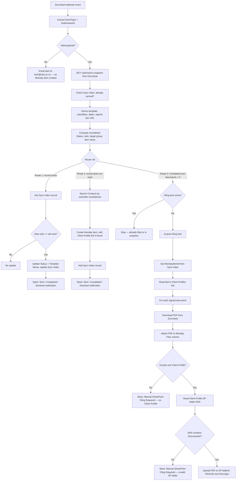

# AUTO-DOCUSEAL-001 — DocuSeal Submission Lifecycle Sync

## 1. Purpose

Create and maintain one Monday.com item per DocuSeal e-signature submission on the `🖊️ DocuSeal Submissions` board, keeping its status, dates and signed-document link current as the submission moves through its lifecycle, linking it to the correct Contact/Client Profile where one can be found, and notifying the team in Slack at key milestones (sent, completed, declined) — without anyone needing to check DocuSeal directly.

When a submission completes, the same scenario downloads each signed PDF from DocuSeal, attaches it to the Monday item's `Files` column, and uploads it to the linked client's SharePoint folder under `h. FileInvite and Docusign` — the same subfolder the DocuSign flow (`AUTO-DOCUSIGN-001`) files into. If the client folder cannot be resolved, a "Manual SharePoint Filing Required" Slack message is posted instead.

## 2. Business context

RSFA is migrating client document signing from DocuSign to DocuSeal (`knowledge/decisions/ADR-002-docusign-to-docuseal-migration.md`). Per RSFA (2026-10-26, reported directly): SharePoint filing has been implemented, multiple tests were completed, and the automation is now used in production. The live checks in §4 corroborate production use with real client submissions.

Whether DocuSign (`AUTO-DOCUSIGN-001`) has been fully retired is not confirmed — see §25.

## 3. Scope

### Included

- Receiving DocuSeal webhook events (`submission.created`, `form.started`, `form.viewed`, `form.completed`, `form.declined`, `submission.completed`, `submission.expired`) and fetching the full submission snapshot from the DocuSeal API.
- Deriving a normalised status (`Draft`, `Sent`, `Viewed`, `Completed`, `Declined`, `Expired`) from the event type and the submission's own status/submitter data.
- Creating a new Monday item on first sight of a submission, attempting to match a submitter's email/phone to a Contact and, through the Contact, to a Client Profile.
- Updating an existing item's status, template name, completion date and signed-document link on later events, guarded so status can only move forward, never backward.
- Sending Slack notifications for Sent, Completed and Declined milestones, and separate technical-failure alerts (email always, Slack for some steps — see §15) to the tech team.
- A per-submission Make Data Store record (`DocuSeal Sync Index (Sep 2026)`, datastore `185679`) used to detect whether a submission has already been synced and to avoid re-sending the same milestone notification. The same datastore also holds a filing lock and a completed-notification lock per submission (§13).
- **Signed-document filing (added after 2026-09-20):** on a Completed submission with at least one document, download every signed PDF from DocuSeal, attach each to the Monday item's `Files` column (`file_mm7f68r4`), and upload each to SharePoint at `<Client Profile SP folder>/h. FileInvite and Docusign/` when exactly one Client Profile is linked and its `SP folder` link is valid.

### Excluded

- Sending or configuring the DocuSeal submission itself (this scenario only reacts to submissions that already exist in DocuSeal).
- Any DocuSign-side processing.
- Moving Monday items between groups after creation (§13, §18).
- Creating missing SharePoint client folders — the scenario only uploads into a folder derived from the Client Profile's existing `SP folder` link.

## 4. Current status

**Active, in production.** Evidence:

- **Confirmed from live system (2026-10-26, Make MCP):** scenario `9803640` is `isActive: true`, `isPaused: false`, last edited 2026-10-26T20:29:20Z by "RSFA IT/tech". The live blueprint is functionally identical (every module's `module`, `parameters`, `mapper` and `filter`) to the export supplied by RSFA on 2026-10-26, now stored at `exports/make/blueprints/9803640-docuseal-submission-lifecycle-sync.blueprint.json`.
- **Confirmed from live system (2026-10-26, Make MCP):** the most recent page of the execution log (2026-10-20 to 2026-10-26) shows about 45 automatic executions, of which 3 ended in error (see §18 "Operational incidents 2026-10-21 → 2026-10-23").
- **Confirmed from live system (2026-10-26, Monday MCP):** the board holds 36 items. 22 have Status `Completed`, and 19 of those have signed PDFs in the `Files` column. Most items relate to real client submissions, so production use with client data is confirmed (no client data is recorded in this repository).
- **Confirmed from live system (2026-10-26, Microsoft 365 MCP):** one signed PDF from a 2026-10-20 completion was found in a client folder at `…/sites/RealSavvyClients/Documents/<client folder>/h. FileInvite and Docusign/`, named per the §12 filename pattern. This confirms the SharePoint upload path end to end for at least one real submission. Other submissions were not checked one by one.
- **Per RSFA (2026-10-26, not independently verified):** multiple tests were completed before production use. Test details were not supplied — see §20.

## 5. Trigger

Instant webhook (`gateway:CustomWebHook`, webhook id `4371210`, module "Webhook: Receive DocuSeal Event") — fires on every DocuSeal webhook delivery. The routing logic (§13) recognises these `event_type` values: `submission.created`, `form.started`, `form.viewed`, `form.completed`, `form.declined`, `submission.completed`, `submission.expired`. Any other event type falls through to a default branch that derives status directly from the fetched submission body (§13).

Scenario settings (from the blueprint): `sequential: false` (webhooks may be processed in parallel), `maxErrors: 3`, `dlq: false`. See §18 for the effect of parallel processing.

## 6. Inputs

- DocuSeal webhook payload: `event_type`, and a submission identifier read with a three-way fallback (`data.submission_id`, then `data.submission.id`, then `data.id`).
- DocuSeal API response for `GET /submissions/{id}` (module 10, via the `docuseal:universal` module — a generic/custom connector, not an official native Make app for DocuSeal): `status`, `completed_at`, `combined_document_url`, `documents[]` (`name`, `url`), `template.name`, `created_by_user.email`, and the `submitters[]` array (`name`, `email`, `phone`, `status`, `sent_at`, `decline_reason`, `role`, `id`).
  - Connection changed from `14378638` (2026-09-20 export) to `14624078`, labelled "Support DocuSeal (support@rsfa.co.nz)" in the 2026-10-26 export.
- Make Data Store `DocuSeal Sync Index (Sep 2026)` (`185679`). Three key families share it:
  - `docuseal_submission:{SubmissionId}` — the main sync record: `MondayItemId`, `LastKnownStatus`, `LastEventTimestamp`, `NotifiedSent`, `NotifiedCompleted`, `NotifiedDeclinedSubmitterIds`, `NotifiedNeedsReview`, `LockTimestamp`.
  - `docuseal_filing:{SubmissionId}` — filing lock (`LastKnownStatus: "FilingLock"`), §13.
  - `docuseal_completed_notified:{SubmissionId}` — completed-notification lock for the existing-item "Just Completed" branch, §13.
- Monday Contacts board (`2074688484`), searched by submitter email/phone via the shared subflow `M.com: Subflow Search Contacts in Monday (Feb 26)` (`8518416`).
- The matched Contact's own `board_relation_mkxpzyfq` column (its Client Profile link) — used to pre-fill the new DocuSeal Submission item's Client Profiles column.
- **Filing:** the DocuSeal Submission item's `Client Profiles` column (`board_relation_mm4qrrxr`, read by module 9207), and the linked Client Profile's `SP folder` link column (`link5` on `Client Profiles` `5024661649`, read by module 9220).
- **Filing:** each signed PDF, downloaded by `http:MakeRequest` (module 9211, `noAuth`, GET on `documents[].url`).

## 7. Outputs

- A new or updated item on `🖊️ DocuSeal Submissions` (`5029524384`). New items are placed by status at creation (§13) and are not moved between groups afterwards.
- Updated `DocuSeal Sync Index (Sep 2026)` Data Store records for the submission.
- Slack messages to an operational channel (`C07R2JNE0J0`) for Sent/Completed/Declined milestones and for "Manual SharePoint Filing Required" cases, and to a technical channel (`C0BDU8F52S0`) for a subset of technical failures (§15).
- Technical-failure emails to `tech@rsfa.co.nz` via `COMP-MAKE-ERROR-001` (subscenario `8732008`) on any step failure, including on a malformed/invalid webhook payload.
- **Filing:** each signed PDF attached to the Monday item's `Files` column (`file_mm7f68r4`).
- **Filing:** each signed PDF uploaded to SharePoint site `Real Savvy | Clients` (`rodschubertfinancialadvice.sharepoint.com`, URL path `/sites/RealSavvyClients`), library `Documents`, folder `<path from Client Profile SP folder>/h. FileInvite and Docusign`, with `conflictBehavior: replace`.

## 8. Systems involved

- **DocuSeal** — source. Reached through a generic/"universal" Make connector rather than an official native app module, so there is no vendor-maintained schema if DocuSeal's API changes. Signed PDFs are downloaded with a plain HTTP GET.
- **Make.com** — execution. Connections:
  - `14624078` — DocuSeal
  - `240128` — Monday, "My Monday v2 connection - 1"
  - `4778199` — Slack, "Make Bot General Slack Connection"
  - `13527429` — SharePoint, "Tech RSFA Microsoft Connection", account `tech@rsfa.co.nz`
- **Monday.com:**
  - `🖊️ DocuSeal Submissions` — destination board.
  - `Contacts` — used for matching.
  - `Client Profiles` — read for its `SP folder` link during filing.
- **SharePoint** — `Real Savvy | Clients` site, `Documents` library.
- **Slack** — two channels; only their IDs are known (§25).
- **Microsoft Outlook** — technical alert emails via `COMP-MAKE-ERROR-001`.

## 9. Related Monday boards

| Board | ID | Role |
|---|---|---|
| 🖊️ DocuSeal Submissions | `5029524384` | Destination board; one item per DocuSeal submission (intended — see §18 duplicates). Renamed from `🖊️ DocuSeal Submissions (WIP)` in the live system — confirmed live 2026-10-26; rename date unknown. |
| Contacts | `2074688484` | Searched by submitter email/phone to resolve a Contact, and read for its Client Profile relation column |
| Client Profiles | `5024661649` | Linked via the Contact's `board_relation_mkxpzyfq` column on item creation. Since filing was added, also read directly (module 9220, `GetItemV2`) for its `SP folder` column (`link5`) |

**Live board schema (Confirmed from live system, 2026-10-26)** — 13 columns:

| Column ID | Title | Type |
|---|---|---|
| `name` | Name | name |
| `multiple_person_mm4qjs43` | Owner (TBD) | people |
| `color_mm4qhhhc` | Status | status |
| `date_mm4q429w` | Sent | date |
| `date_mm4qbe7` | Completed | date |
| `file_mm7f68r4` | Files | file |
| `board_relation_mm4qrrxr` | Client Profiles | board_relation → `5024661649` |
| `lookup_mm7g66pp` | Client SP Folder | mirror of `Client Profiles`.`link5` |
| `email_mm4qvnap` | Primary Submitter Email | email |
| `text_mm4qr449` | Template Name | text |
| `text_mm4qr3yv` | DocuSeal Submission ID | text |
| `link_mm4qk8jv` | Signed Document URL | link |
| `long_text_mm4qcg9q` | Error Message | long_text |
| `multiple_person_mm8h6049` | Adviser | people — added 2026-10-27, filled manually; used by `AUTO-DOCUSEAL-002` |
| `email_mm8hpzzs` | Alternative Submitter Email | email — added 2026-10-27 |
| `board_relation_mm8hgw4t` | Template | board_relation → `📄 DocuSeal Templates` (`5032131811`), single item — added 2026-10-27 |

The last three columns were added on 2026-10-27 for `AUTO-DOCUSEAL-002` (Send Now). This scenario does not write them yet — see the staged change in §25.

The Status labels are New, Draft, Send Now, Viewed, Sent, Completed, Declined, Expired, Error and Archived. This scenario writes only Draft, Sent, Viewed, Completed, Declined and Expired.

The `Sent` and `Completed` date columns were titled `Sent At` and `Completed At` in the 2026-09-20 schema export.

**Live groups (Confirmed from live system, 2026-10-26):**

| Group ID | Title |
|---|---|
| `group_mm4qa1h0` | New |
| `group_mm8a3b4m` | Draft |
| `group_mm8amqn1` | Viewed |
| `group_mm8asefr` | Sent |
| `group_mm7fv39s` | Completed |
| `group_mm4q1z3r` | Error |
| `group_mm8ak0wh` | Expired |
| `group_mm8ana3r` | Archived |

No Monday automations or workflows exist on the board (confirmed live 2026-10-26).

## 10. Platform implementation

### Make.com scenarios

| Scenario ID | Exact Make name | Role | Status | Trigger | Calls | Called by | Source confidence |
|---|---|---|---|---|---|---|---|
| `9803640` | M.com: DocuSeal Submission Lifecycle Sync (Sep 2026) | Parent | Active | Webhook (custom webhook, instant) | `8518416` (contact search), `8732008` (error email) | None confirmed | Confirmed from live system 2026-10-26 (live blueprint matches export) |
| `8518416` | M.com: Subflow Search Contacts in Monday (Feb 26) | Shared component | Active | On-demand (subscenario) | — | Confirmed callers per `knowledge/03_AUTOMATION_REGISTRY.md` §8 plus this scenario | Current |
| `8732008` | Outlook: Email Notification after Failed Scenario | Shared component (`COMP-MAKE-ERROR-001`) | Active | On-demand (subscenario) | — | Called by nearly every `onerror` branch in this scenario (§15) | Current |

Scenario folder id `296569`; created 2026-09-14T03:34:51Z (Confirmed from live system).

### Power Automate flows

Not applicable.

### Monday native automations or workflows

None — confirmed live 2026-10-26 (`list_automations` on `5029524384` returned no workflows or automations).

### Native integrations

Not applicable — DocuSeal integrates via a Make.com webhook and a custom/universal connector, not a native Monday connector.

### Shared subflows and components

- `COMP-MAKE-ERROR-001` (`8732008`) — called by the invalid-payload branch and by nearly every step's `onerror` handler, including every filing step.
- `M.com: Subflow Search Contacts in Monday (Feb 26)` (`8518416`) — called once per new (not-yet-synced) submission to resolve a Contact from submitter email/phone.

## 11. End-to-end process

Router 39 has three routes. Make runs them in order for each bundle, so the filing route (3) runs after the existing-item (1) or new-item (2) route has finished. On a brand-new submission, that means the Sync Index record already exists when filing reads it.

Any failure in a filing step sends a technical email and deletes the filing lock (§15).

## 12. Data mapping

### Monday item columns

| DocuSeal / derived field | Monday column (ID) | Written | Notes |
|---|---|---|---|
| `TemplateShort` + `RecipientLabel` + `SentDateFormatted` | `name` | Create only | e.g. "Sample Document - Jane Example - 15 September 2026" (fictional example) |
| Resolved Client Profile (via Contact) | `board_relation_mm4qrrxr` (Client Profiles) | Create only (new item, contact-found branch) | Never re-linked or corrected on later events; a no-contact-found item is never retroactively linked |
| First submitter's email | `email_mm4qvnap` (Primary Submitter Email) | Create only | |
| `EarliestSentAt` | `date_mm4q429w` (Sent) | Create only | |
| `CompletedAt` | `date_mm4qbe7` (Completed) | On Completed with a completion date present | Written by overlapping branches — see §18 |
| Normalised `NewStatus` | `color_mm4qhhhc` (Status) | Create, and on every later event (forward-only guard, §13) | |
| DocuSeal `template.name` | `text_mm4qr449` (Template Name) | Create, and re-written on every later existing-item update | |
| DocuSeal submission ID | `text_mm4qr3yv` (DocuSeal Submission ID) | Create only | |
| `SignedDocUrl` (`combined_document_url`) | `link_mm4qk8jv` (Signed Document URL) | On Completed with both a completion date and a signed-doc URL present | |
| Downloaded signed PDF(s) | `file_mm7f68r4` (Files) | Filing route, once per document | Added before the SharePoint routing, so every filed submission gets its PDFs on Monday even when SharePoint filing falls back to manual |
| — | `long_text_mm4qcg9q` (Error Message) | Never written | |
| `OwnerPersonId` (computed, never used) | `multiple_person_mm4qjs43` (Owner (TBD)) | Never written | |

### Signed-document filename (modules 9214, 9230)

Built as follows:

1. Start from the DocuSeal document `name`, or the template name if `name` is empty.
2. Remove `.pdf` and replace `/` and `:` with `-`.
3. If the submission has more than one document, append `_` and the document's position (1-based).
4. Append `_Ref{SubmissionId}`.
5. Append `_` and the completion date formatted as `MMMMYY` (falling back to "now" if there is no completion date), then `.pdf`.

Fictional example: `Client Agreement_1_Ref12345678_October26.pdf`.

### SharePoint target (module 9230)

- **Site:** `rodschubertfinancialadvice.sharepoint.com`, site `Real Savvy | Clients`.
- **Drive:** `Documents` library.
- **Folder:**
  1. Take the Client Profile's `link5` text.
  2. Keep the last ` - `-separated segment, then the text after `/Documents/`, cut at `?`.
  3. URL-decode the result.
  4. Append `/h. FileInvite and Docusign`.
- **Conflict behaviour:** `replace`.

The `h. FileInvite and Docusign` subfolder is the same target used by `AUTO-DOCUSIGN-001` (confirmed from `exports/power-automate/solutions/docusign-to-sharepoint/`).

## 13. Decision and routing logic

**Event → status mapping** (module 21):

| `event_type` | Resulting status |
|---|---|
| `submission.completed` | Completed |
| `submission.expired` | Expired |
| `form.declined` | Declined |
| `form.viewed`, `form.started` | Viewed |
| `submission.created` | Sent if any submitter status contains "sent", else Draft |
| `form.completed` | Completed if the submission body's own `status` is "completed"; otherwise Viewed if the completing submitter has `opened_at` (a person opened the form), else Sent. Since 2026-10-27, the API auto-completed adviser role from `AUTO-DOCUSEAL-002` never opens the form, so it no longer moves the item to Viewed |
| any other value | Derived from the submission body: Completed / Declined / Expired if the body's `status` says so; otherwise Viewed if any submitter is "completed" or "opened", Sent if any submitter is "sent", else Draft |

**Forward-only guard:** each status is ranked (Draft=0, Sent=1, Viewed=2, Completed/Declined/Expired=4). An existing item is only updated if the new event's rank is `>=` the last known rank, so a late-arriving "viewed" webhook can never revert an already-Completed item back to Viewed.

**Group routing (module 22, applied only when the item is created):**

| Status at creation | Target group | Live group (2026-10-26) |
|---|---|---|
| Completed | `group_mm4q8vrz` | **Not present on the live board** — see §18 |
| Declined or Expired | `group_mm4q1z3r` | `Error` |
| Draft, Sent or Viewed | `group_mm4qa1h0` | `New` |

The scenario never moves items between groups after creation.

**Contact/Client Profile resolution (new items only):** the submitter's emails and phones are searched against the Contacts board via the shared subflow (`8518416`). If a Contact is found, its own Client Profile relation column (`board_relation_mkxpzyfq`) is read and copied onto the new DocuSeal Submission item. If no Contact is found, the item is still created, just without a Client Profile link.

**Filing route (router 39, route 3):**

1. **Entry filter (module 9200):** `NewStatus = Completed` and `length(documents) > 0`.
2. **Filing lock:**
   - `ExistRecord` on `docuseal_filing:{SubmissionId}`. If the lock exists, filing stops.
   - Otherwise `AddRecord` with `overwrite: false` (module 9202). Its error handler is `Ignore`, so if another parallel run created the lock first, this run drops out silently.
   - On success the lock is never removed; it stays as the permanent "already filed" marker.
   - Every filing step's error handler emails the tech team and deletes the lock, so a later Completed event for the same submission can retry.
3. **Monday item ID:** read from `docuseal_submission:{SubmissionId}` (module 9204). Filing continues only if `MondayItemId` exists (module 9207 filter).
4. **For each document** in `documents[]` (`BasicFeeder` 9210), when the document has a `url`:
   1. Download it (9211).
   2. Attach it to Files (9214).
   3. Route on the Client Profile link:
      - Exactly 1 linked Client Profile → read the profile (9220), then:
        - `link5` contains `/Documents/` (case-insensitive) → upload (9230).
        - Otherwise → Slack "Manual SharePoint Filing Required (invalid SP folder)" (9233).
      - 0 or more than 1 linked → Slack "Manual SharePoint Filing Required (no Client Profile)" (9234).

**Completed-notification lock (existing-item route 3, module 9240):** before the "Just Completed" Slack message (9107), the scenario adds `docuseal_completed_notified:{SubmissionId}` with `overwrite: false`. Its error handler is `Ignore`, so a second parallel run for the same completion drops out instead of posting a duplicate message.

## 14. Dependencies

- `M.com: Subflow Search Contacts in Monday (Feb 26)` (`8518416`) for Contact resolution on new submissions.
- The Contacts board's `board_relation_mkxpzyfq` column continuing to point to the correct Client Profile.
- **Filing:** the `Client Profiles` board's `SP folder` (`link5`) value being a correct SharePoint link that contains `/Documents/`. It is typically maintained by the SharePoint client-folder flows — TODO: verify the exact owning automation. The target client folder must already exist (§3 Excluded).
- **Filing:** the SharePoint connection `13527429` (`tech@rsfa.co.nz`) keeping write access to the `Real Savvy | Clients` `Documents` library.
- **Filing:** DocuSeal `documents[].url` staying downloadable without authentication at the time the webhook is processed (Inference — the download module uses `noAuth` and has worked in production; how long the URLs stay valid is unknown).
- The `DocuSeal Sync Index (Sep 2026)` Data Store (`185679`) staying internally consistent.
- `COMP-MAKE-ERROR-001` (`8732008`) for all technical-failure emails. A failure inside this subscenario can stop the parent scenario (§18).

## 15. Error handling

Every step (DocuSeal GET, Data Store reads/writes, Monday reads/writes, the contact-search subflow call, and every filing step) has an `onerror` handler that calls `COMP-MAKE-ERROR-001` to email `tech@rsfa.co.nz`. Coverage is inconsistent for the secondary Slack technical-channel (`C0BDU8F52S0`) alert:

- **Email + Slack technical alert:** the initial DocuSeal GET (module 10), both Monday "get Client Profile column" calls on the lifecycle routes (modules 9014, 61), and both Monday "create item" calls (modules 70, 9081).
- **Email only, no Slack alert:** the Sync Index GetRecord/UpdateRecord calls (modules 40, 52), the Monday status-update call on the existing-item path (module 50), the contact-search subflow call (module 60), the Sync Index AddRecord call (module 71).
- **Email only, plus the filing lock is released (deleted):** the filing steps:
  - filing-lock check (9200 — email only; no lock exists yet to release)
  - Sync Index read (9204)
  - Client Profile link read (9207)
  - PDF download (9211)
  - Files-column attach (9214)
  - Client Profile read (9220)
  - SharePoint upload (9230)
- **Silently ignored:** the filing-lock `AddRecord` (9202) and the completed-notification-lock `AddRecord` (9240). Both use `Ignore` on error by design, to drop duplicate parallel runs. As a side effect, any other failure of these two writes, such as a datastore outage, is also silent.

A filing failure produces only an email, not a Slack message. The "Manual SharePoint Filing Required" Slack messages are business fallbacks (no single Client Profile, or invalid `SP folder` link), not technical-failure alerts.

An invalid webhook payload (missing `event_type`, or no resolvable submission ID) also only sends the technical email — no Slack alert, and no Monday item.

## 16. Logging and observability

- **Sync Index Data Store:** the only per-submission processing log.
  - `docuseal_filing:{id}` records show which submissions have been filed (or are mid-filing).
  - `docuseal_completed_notified:{id}` records show which existing-item completions have been notified.
- **Monday `Files` column:** shows which submissions had their PDFs downloaded and attached. It does not show whether the SharePoint upload succeeded.
- **No log board:** there is no dedicated Monday log board for this automation.
- **Unused Data Store fields:** `NotifiedNeedsReview` and `LockTimestamp` on the main `docuseal_submission:*` record are still never meaningfully used. The filing and completed-notification locks set `LockTimestamp` on their own records only.

## 17. Manual operations and reprocessing

**Confirmed from live system (2026-10-26):**

- Executions are marked `isReplayable: true` in the Make execution log.
- On 2026-10-23, queued webhooks were processed after a manual scenario restart (§18). This shows deliveries are queued while the scenario is stopped.

**Manual filing:**

- **When a "Manual SharePoint Filing Required" Slack message is posted:** the signed PDF is already in the Monday item's `Files` column. Download it from there and upload it to the client's `h. FileInvite and Docusign` folder. Link or fix the item's Client Profile for future reference.
- **After a filing failure (email alert):** the filing lock has been released, but filing only retries on another Completed webhook for the same submission, which normally doesn't arrive. Treat a filing-failure email as requiring manual filing unless the submission is reprocessed.

TODO: verify with RSFA whether a Make execution replay is the approved reprocessing method for this scenario. Replaying would re-run Monday/Slack steps. The locks prevent duplicate filing and duplicate existing-item Completed messages, but not every notification branch is guarded (§18).

## 18. Known limitations

Items below are read from the blueprint logic or confirmed in the live system, as labelled. They are flagged here rather than silently corrected (CLAUDE.md §5) and have not been confirmed with RSFA as intentional.

### Operational incidents 2026-10-21 → 2026-10-23 (Confirmed from live system — Make execution log, 2026-10-26)

1. **Scenario stopped:** on 2026-10-21T22:20Z an execution failed in a `CallSubscenario` step with `BundleValidationError`. Make logged the warning "Failed to verify connection 'Support@ Email Used'. "invalid_grant"" and the scenario stopped.
2. **Restart and backlog:** it was restarted manually by "RSFA IT/tech" on 2026-10-23T20:52:38Z, about 47 hours later. About 27 queued webhooks were then processed within about 2 seconds.
3. **Second stop:** during that burst, two executions failed on the DocuSeal `GET /submissions/{id}` call with HTTP 404. Make then logged `[429] Application is over its MailboxConcurrency limit` from `microsoft-email`, and the scenario stopped again. It was restarted at 2026-10-23T20:54:06Z.
4. **Inference:** the failing connection and the Outlook 429 both appear to belong to the error-email path (`COMP-MAKE-ERROR-001`). If so, a failure in the alerting component itself can halt this production scenario. TODO: verify which connection "Support@ Email Used" is and which module raised the `BundleValidationError`. The execution detail returned only the top-level error.

Recommended: record this as an incident under `knowledge/incidents/` using `templates/incident-template.md`.

### Data-quality issues observed on the live board (Confirmed from live system — Monday, 2026-10-26)

- **Apparent duplicate items:** 8 items were created within the same second (2026-10-23T20:52:46–47Z) during the backlog burst. They include three sets of identically named items (3, 2 and 2 items).
  - Inference — likely cause: the scenario runs with `sequential: false`. The "already synced?" check (module 12) and the Sync Index `AddRecord` (module 71) are not atomic, so parallel webhooks for the same submission can each take the new-item route. Unlike filing and existing-item completion, the new-item route has no lock.
  - TODO: verify by comparing the `DocuSeal Submission ID` column on the duplicate items.
- **Status and Files out of step:** two of those burst items show Status `Sent`, an empty `Completed` date, and a signed PDF in `Files`. This is consistent with filing attaching the PDF to whichever item ID the Sync Index held while a different duplicate received (or missed) the status update (Inference).
- **Completed but not filed:** one item with Status `Completed` (created 2026-10-05) has no `Completed` date and no `Files` entry. TODO: verify whether its signed PDF reached SharePoint.
- **Not filed — completed before filing existed:** two Completed items from 2026-09-15 and 2026-09-21 completed before filing was built. The earliest `Files` attachment observed is from a 2026-09-26 completion (Inference: filing went live around 2026-09-25/26).

### Group routing

- **Completed items:** items created already-Completed are routed to `group_mm4q8vrz`, which no longer exists on the live board (§9, §13). TODO: verify what Monday does with these creates — reject them, or place them in the top group (`New`). No live failure attributable to this was seen in the execution log page reviewed.
- **Declined and Expired items:** these are created in `group_mm4q1z3r`, now titled `Error`.
- **No automatic group moves:** the scenario never moves items between groups, and no Monday automations exist on the board. The `Draft`, `Viewed`, `Sent`, `Completed`, `Expired` and `Archived` groups are therefore maintained manually (Inference). One live item with Status `Completed` sits in the `Viewed` group.

### Filing logic (read from blueprint)

- **Filing silently skipped when there is no Monday item ID:** if the main Sync Index record has no `MondayItemId` (for example after the Declined-branch clearing below), the filing route stops at module 9207's filter. There is no alert, and the filing lock is not released, so the submission is never filed automatically.
- **Folder check is shallow:** the "valid SP folder" check only tests that `link5` contains `/Documents/`. A link to a renamed or moved folder passes the check. The upload then targets a path that may not exist — expected to fail into the email alert path (Inference; not tested).
- **Overwrites:** `conflictBehavior: replace` overwrites a same-named file in the target folder. The `_Ref{SubmissionId}` part of the filename makes collisions unlikely except on reprocessing.
- **Signed PDFs stored on Monday:** every signed PDF is also stored on the Monday item — see §19.

### Notification logic (unchanged since 2026-09-20 — every pre-existing module is identical to the earlier export apart from the DocuSeal connection ID)

- **Existing-item Sent notification likely never fires.** Module 9022 requires `NotifiedSent == true`, the opposite of "not yet notified". A submission that becomes Sent after its Monday item already exists does not trigger this Slack message. New items already Sent at creation use a correctly gated branch (module 9035).
- **Existing-item Completed notification has the same inversion.** Module 9024 checks `NotifiedCompleted == true`. The parallel "Just Completed" branch (modules 9106 → 9240 → 9107 → 9108) checks `!= true` correctly, and is now also protected by the completed-notification lock (9240).
- **Declining an existing submission clears its own Monday-item link.** Module 9027 writes `MondayItemId`, `LastKnownStatus` and `LastEventTimestamp` back to `""` on the Sync Index record.
- **New-item Declined notifications have no duplicate guard.** Module 9037 never updates `NotifiedDeclinedSubmitterIds`.
- **Unused columns and variable:** the `Error Message` and `Owner (TBD)` columns and the `OwnerPersonId` variable are still unused.
- **Inconsistent technical-alert coverage** — see §15.

## 19. Security and sensitive data

This scenario now processes **real client e-signature submissions and signed documents in production**, so the earlier test-data-only restriction no longer describes current use.

- **Where signed documents end up:**
  - In the client's SharePoint folder — the approved storage location.
  - As copies in the Monday `🖊️ DocuSeal Submissions` board's `Files` column. This board is a `public` board (all board members) in the `Real Savvy_CRM` workspace. Whether keeping signed client documents on this board is acceptable has not been confirmed — TODO: verify with RSFA.
- **Make execution history:** this may retain submitter names, emails and document metadata in execution logs and module outputs.
- **Download without authentication:** signed PDFs are downloaded with an unauthenticated HTTP GET on the DocuSeal document URL. That URL must be treated as sensitive, as must the `Signed Document URL` column value.
- **Credential storage:** credentials are held in Make connections:
  - `14624078` — DocuSeal
  - `240128` — Monday
  - `4778199` — Slack
  - `13527429` — SharePoint
- **Blueprint export:** none of the connections' secret values appear in the blueprint export (checked 2026-10-26).
- **Testing:** use fictional test identities and documents (CLAUDE.md §13). Never reuse real client documents as test input.

## 20. Testing

### Confirmed tests

| Test | Result | Evidence |
|---|---|---|
| New item already Sent, then Completed, with Client Profile link, Slack Sent + Completed messages | `Passed` | Slack screenshot supplied 2026-09-20 (test identity) |
| Completed submission with multiple documents → each PDF attached to `Files` with `_1`, `_2`, … suffix | `Passed` | Confirmed from live system 2026-10-26 (several Completed items show 2–3 suffixed PDFs) |
| Completed submission → signed PDF uploaded to client `h. FileInvite and Docusign` folder with expected filename | `Passed` | Confirmed from live system 2026-10-26 (one file located in SharePoint) |
| Pre-production test cycle reported by RSFA | `Partially verified` | Per RSFA 2026-10-26, "multiple tests were completed". Test cases and results were not supplied. |
| Webhook backlog / concurrent delivery for the same submission | `Failed` | 2026-10-23 burst produced apparent duplicate items and Status/Files mismatches (§18) |

### Required regression tests

Status is `Planned` unless marked otherwise.

- New submission, contact match found → item created with correct Client Profile link, group and initial status.
- New submission, no contact match → item created without a Client Profile link.
- Existing item receiving a later event with a higher-ranked status → status, template name updated; forward-only guard respected.
- Existing item receiving an equal or lower-ranked status (duplicate/out-of-order webhook) → no regression of the Status column.
- Existing item transitioning to Sent → confirm whether the Sent Slack notification fires (§18).
- Existing item transitioning to Completed → exactly one Completed Slack message.
- Existing item transitioning to Declined → confirm the cleared Sync Index fields don't break a later event or filing.
- Multi-submitter submission (2, and 3+ submitters) → correct `RecipientLabel` text.
- Malformed webhook payload → technical email sent, no Monday item created.
- **Filing:**
  - Completed with exactly one Client Profile with a valid `SP folder` → PDFs in Files and SharePoint.
  - No Client Profile → Slack manual-filing message, PDFs in Files only.
  - Two or more Client Profiles → Slack manual-filing message.
  - `SP folder` link without `/Documents/` → Slack manual-filing message.
  - `SP folder` points to a missing folder → technical email, lock released.
  - Repeated `submission.completed` webhook → no second upload (lock).
  - Several webhooks for the same submission delivered at the same instant → single Monday item (currently fails, §18).
  - Item created directly as Completed → confirm group placement given the missing `group_mm4q8vrz`.

### Test data restrictions

Use a dedicated fictional test DocuSeal submission, test Client Profile/Contact (with a test SharePoint folder), and test documents only — never real client signatures or documents (§19).

## 21. Validation after change

1. Send a fictional test DocuSeal submission through its full lifecycle (created → sent → viewed → completed).
2. Confirm a single Monday item is created and progressively updated, not duplicated.
3. Confirm the Client Profile link is correct.
4. Confirm exactly one Slack notification per milestone.
5. Confirm the signed PDF(s) appear in the item's `Files` column and in the test client's `h. FileInvite and Docusign` SharePoint folder with the expected filename.
6. Confirm Sync Index records exist for `docuseal_submission:`, `docuseal_filing:` and (on the existing-item path) `docuseal_completed_notified:` with the expected values.

## 22. Rollback

- **Stopping the automation:** disable the DocuSeal webhook and/or the Make scenario. While the scenario is stopped, incoming webhooks queue (§17) and are processed in a burst on restart. Read §18 before restarting after a long stop.
- **Already-created data:** no automated rollback exists for Monday items, Files attachments, Sync Index records or SharePoint uploads. Affected items and files need manual review.
- **Previous blueprint version:** available in this repository's Git history for `exports/make/blueprints/9803640-docuseal-submission-lifecycle-sync.blueprint.json` (the 2026-09-20 version, without filing).

## 23. Troubleshooting guide

1. Confirm the DocuSeal event actually fired (DocuSeal webhook delivery log, if accessible).
2. Check the scenario is running (Make: active, not stopped with a queue warning). Since 2026-10-21, a failure in the alert subscenario has been seen to stop it (§18).
3. If a Monday item is missing entirely, check for a technical-failure email at `tech@rsfa.co.nz` and check the invalid-payload branch (module 90).
4. If there are several items for one submission, compare their `DocuSeal Submission ID` values. Check which item ID the Sync Index `docuseal_submission:{id}` record holds — that is the item filing and status updates target.
5. If a signed PDF is not in SharePoint:
   1. Check the item's `Files` column — if empty, the filing route didn't run or failed before attach.
   2. Look for a "Manual SharePoint Filing Required" Slack message.
   3. Look for a filing technical email.
   4. Check whether `docuseal_filing:{id}` exists. If it exists with no upload, see the "silently skipped" limitation in §18.
   5. Check the Client Profile's `SP folder` (`link5`) value.
6. If a Sent or Completed Slack notification didn't fire for an already-tracked submission, check the §18 notification-logic findings first.
7. If a Client Profile link is missing or wrong, confirm the submitter's email/phone matches a Contact record and that the Contact's own Client Profile relation is set. The link is only set at item creation — set it manually afterwards.
8. If a previously-Declined submission's later events seem to fail silently, check whether its Sync Index record has a blank `MondayItemId` (§18).

## 24. Source references

- **Blueprint export (2026-10-26):** `M.com: DocuSeal Submission Lifecycle Sync (Sep 2026)`, supplied by RSFA. Stored unmodified at `exports/make/blueprints/9803640-docuseal-submission-lifecycle-sync.blueprint.json`, replacing the 2026-09-20 export (still in Git history). Checked for secrets and client data before commit: none found.
- **Live Make scenario `9803640` (Make MCP, 2026-10-26):**
  - `scenarios_get` — functionally identical to the export.
  - `executions_list` — log page covering 2026-10-20 to 2026-10-26.
  - `executions_get-detail` for execution `49771deb402240bba4e0df2c71442e38`.
- **Live Monday boards (Monday MCP, 2026-10-26):**
  - `get_board_info` for `5029524384` (columns, groups) and `5024661649` (`link5`).
  - `list_automations` for `5029524384`.
  - `get_board_items_page` for `5029524384` (Status, Files, Completed columns only).
- **Live SharePoint (Microsoft 365 MCP, 2026-10-26):** one signed-PDF search, confirming the upload path and filename pattern.
- **DocuSeal Integration Use Guide (PDF):**
  - Author "RSFA Tech", created 2026-10-07, 6 pages, supplied by RSFA in chat 2026-10-26. Not committed to this repository; source storage location TODO: verify.
  - **Discrepancy within the guide:** §6 describes SharePoint filing as active, while §1, §2 and §9 still say filing "has not been built". Its group names ("Client Active Filing", "Completed", "Declined / Expired") do not match the live board's groups (§9).
  - The guide should be revised. This document follows the blueprint and live evidence.
- **Make scenario link:** `https://eu2.make.com/85772/scenarios/9803640/edit` (team `85772`, org `882256`, zone `eu2.make.com`).
- **Earlier evidence (Historical information):** the 2026-09-20 blueprint export, column-schema export and Slack screenshot described in this document's first version.
- **Related registry entries:**
  - `knowledge/03_AUTOMATION_REGISTRY.md` §8 — shared search subflow `8518416`.
  - `knowledge/02_SYSTEMS_REGISTRY.md` — `SYS-DOCUSEAL-001`, `SYS-DOCUSIGN-001`.
  - `exports/power-automate/solutions/docusign-to-sharepoint/` — confirms the shared `h. FileInvite and Docusign` target folder.

## 25. Known gaps

- **Slack channel names:** the display names of `C0BDU8F52S0` and `C07R2JNE0J0` are unconfirmed — TODO: verify against `knowledge/systems/slack/`.
- **Notification logic:** whether the §18 notification-logic findings are intentional has not been confirmed with RSFA.
- **2026-10-21 → 23 stoppage:** root cause not fully confirmed (connection identity, failing module) — TODO: verify; incident record not yet written.
- **Duplicate items:** the duplicates from 2026-10-23 are not yet confirmed by Submission ID, and the affected items have not been cleaned up — TODO: verify with RSFA.
- **Missing group:** behaviour of item creation into the missing `group_mm4q8vrz` — TODO: verify.
- **Monday Files column:** whether storing signed PDFs in the Monday `Files` column is approved — TODO: verify.
- **RSFA test cycle:** test cases and results were not supplied.
- **DocuSign cutover:** whether DocuSign (`AUTO-DOCUSIGN-001`) has been retired or still runs in parallel is not confirmed — TODO: verify.
- **SP folder link ownership:** the automation that owns the `Client Profiles` `SP folder` (`link5`) value — TODO: verify.
- **Use guide:** the DocuSeal Integration Use Guide is internally inconsistent and needs revising (§24).
- **Change applied 2026-10-27 (00:50 UTC, approved by RSFA) for `AUTO-DOCUSEAL-002`:**
  1. **Skip Monday-sent submissions on the new-item route:** module 60's filter gains the condition `first(map(10.body.submitters; "external_id"))` does not exist. Submissions created by Send Now carry the Monday item ID as `external_id`, and their Sync Index record is written by `AUTO-DOCUSEAL-002`. Without this, a `submission.created` webhook processed before that record exists would create a duplicate item. Inert for submissions created in DocuSeal directly.
  2. **Find the template (new module 9250):** a Monday GraphQL `items_page_by_column_values` call looks up the DocuSeal template ID on the `📄 DocuSeal Templates` board. It always returns one bundle, even when nothing matches. On error: email, then `Resume`, so the item is still created.
  3. **Fill the new columns:** both create-item modules (70, 9081) also write `Alternative Submitter Email` (`submitters[2].email`) and `Template` (the template item found in step 2).
  - **How it was applied:**
    - The change was built from the live blueprint, which matched the 2026-10-26 export.
    - The full blueprint was sent through the Make MCP connector, without the editor-only test samples and input/output schema metadata.
    - Re-read afterwards: all 95 modules matched the target exactly, and only modules 60, 70, 9081 and the new 9250/9251/9252 differ from the previous version.
    - The scenario stayed active throughout.
  - **Rollback:** restore the previous blueprint from this repository's Git history for `exports/make/blueprints/9803640-docuseal-submission-lifecycle-sync.blueprint.json` (commit `cd10e73` or earlier).
  - **Behaviour not yet observed in a real run:** template link and Alternative Submitter Email on a new item; skipping of a Monday-sent submission. TODO: verify on the first executions.

## 26. Change history

| Date | Change | Author |
|---|---|---|
| 2026-09-20 | Initial canonical documentation created from the RSFA-supplied blueprint export and a corroborating Slack screenshot; several notification-logic and unused-field discrepancies flagged, not silently resolved. | Claude (documentation task) |
| 2026-10-27 | Module 21 (`NewStatus`): `form.completed` without `opened_at` now maps to Sent instead of Viewed, so the adviser auto-completion from Send Now no longer marks items Viewed. RSFA-approved; live blueprint verified identical to target (only module 21 changed); export replaced. Confirmed from a stored webhook sample that `form.completed` payloads include `opened_at`. | Claude (implementation task) |
| 2026-10-27 | Applied the approved Lifecycle Sync change to `9803640` (module 60 filter, new template lookup 9250, new columns on 70/9081), verified identical to the target blueprint, and replaced the export snapshot. | Claude (implementation task) |
| 2026-10-27 | Recorded the three new board columns added for `AUTO-DOCUSEAL-002` and the staged, not yet applied, Lifecycle Sync change (§25). No change made to scenario `9803640`. | Claude (implementation task) |
| 2026-10-26 | Documented the SharePoint/Monday Files signed-document filing route (modules 9200–9234), the filing and completed-notification locks, the DocuSeal connection change and production status. Based on the RSFA-supplied 2026-10-26 blueprint and use guide, plus live checks of Make, Monday and SharePoint. Recorded the live board rename and new schema/groups, the 2026-10-21 → 23 stoppage, duplicate items and the missing-group routing as discrepancies. Replaced the blueprint export snapshot. | Claude (documentation task) |
