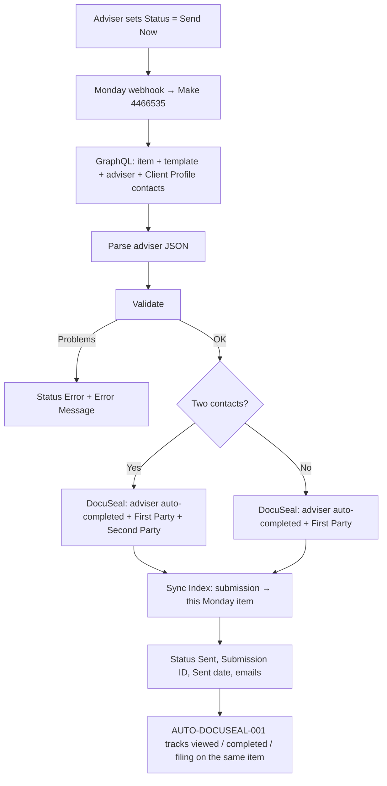

# AUTO-DOCUSEAL-002 — DocuSeal Send Now from Monday

## 1. Purpose

Allow an adviser to send a DocuSeal signature request from Monday. The adviser:

1. Creates an item on `🖊️ DocuSeal Submissions`.
2. Links one **Client Profile**, picks a **Template** (`📄 DocuSeal Templates`) and selects an **Adviser**.
3. Sets **Status** to **Send Now**.

The scenario then validates the request, reads the client contacts and the adviser's details, creates and sends the DocuSeal submission to the client(s), links it to the item for lifecycle tracking, and sets Status to **Sent**. Problems are written to the item's **Error Message** column.

## 2. Business context

- **Why:** requested by RSFA (2026-10-27) to reduce adviser effort after the DocuSign → DocuSeal migration (`knowledge/decisions/ADR-002-docusign-to-docuseal-migration.md`).
- **Scope:** RSFA chose to start with the 5 templates in the DocuSeal folders `TEMPLATES: NSA + Dec` and `TEMPLATES: NSA (only)` as a proof of concept. More complete templates will follow once the approach is proven.
- **Responsibility:** the adviser is responsible for choosing the correct Template and Adviser. RSFA explicitly asked for no template ↔ adviser consistency check. DocuSeal itself rejects a mismatch, because the adviser signing role does not exist on another adviser's template (§13).

## 3. Scope

### Included

- Trigger on the Status column changing to `Send Now`.
- Validation, with an adviser-friendly message in `Error Message` and Status set to `Error`:
  - exactly one Client Profile linked
  - one Template linked, with `Send Now Enabled` ticked on the Templates board
  - an Adviser selected who exists in the adviser list
  - the Client Profile has Contacts
  - every client used has a Primary Email
  - the item has not already been sent (DocuSeal Submission ID is empty)
- **Clients:** the first one or two Contacts linked to the Client Profile (`board_relation38`). If 3 or more are linked, the first two are used, as agreed with RSFA. Which contact becomes Client 1 is not significant.
- **Adviser details:** taken from the adviser JSON (§6).
- **DocuSeal submission:**
  - The adviser role is marked `completed: true` (auto-signed, no email).
  - Client 1 is `First Party`; Client 2, if present, is `Second Party`.
  - Every signer gets `external_id` = Monday item ID.
  - Client full names are pre-filled into `Client 1 full name` / `Client 2 full name`.
  - DocuSeal sends the signing emails, with order `random` so both clients receive them at the same time.
- **Linking for tracking:** writes the `DocuSeal Sync Index (Sep 2026)` record `docuseal_submission:<id>` → Monday item, so `AUTO-DOCUSEAL-001` updates this item through the rest of the lifecycle (viewed, completed, SharePoint filing).
- **Item update after sending:**
  - Status `Sent`
  - DocuSeal Submission ID
  - Sent date (today, NZ time)
  - Template Name
  - Primary / Alternative Submitter Email
  - Error Message cleared

### Excluded

- Pre-filling DOB, address, phone, middle name or adviser details (FSP, phone and so on). These are already fetched (§6), but the 5 current templates have no fields for them. Add fields with agreed names to the templates first (§18).
- Checking that the Template belongs to the selected Adviser — by RSFA decision (§2).
- Re-sending an item that was already sent. The adviser must create a new item.
- Lifecycle tracking after sending (`AUTO-DOCUSEAL-001`).

## 4. Current status

**Planned — built but inactive. Not tested. Do not activate until §21 is complete.**

**Confirmed from live system (2026-10-27):**

- Scenario `10048497` exists in Make folder `296569`, `isActive: false`, created by "RSFA IT/tech" via the Make MCP connector.
- Webhook `4466535` ("DocuSeal Send Now - Monday Status webhook") is attached to it.
- **No Monday webhook has been registered to call it yet**, so nothing can trigger it.

## 5. Trigger

- **Make side:** custom webhook `4466535` (`https://hook.eu2.make.com/<udid>`; full URL in Make).
- **Monday side:** to be registered on board `5029524384` for changes to the `Status` column (`color_mm4qhhhc`) — see §21 step 4.
- **Filter on module 2:** `event.value.label.text = "Send Now"` and `event.pulseId` exists.
- **Scenario settings:** `sequential: true`. Webhooks are processed one at a time, so a quick second "Send Now" on the same item finds the Submission ID already filled and is rejected by validation. No extra lock module is needed.

## 6. Inputs

- **Monday GraphQL (module 2):** one call returns:
  - the item's `DocuSeal Submission ID`
  - the `Adviser` people column (user ID)
  - the linked Template's name, `DocuSeal Template ID` (`text_mm8hb4mz`) and `Send Now Enabled` (`boolean_mm8h7pje`, text `"v"` when ticked)
  - the linked Client Profile and, for each of its Contacts:
    - item name (used as full name)
    - First / Middle / Last Name (`text_mkxdmy0m` / `text_mkxdsxhn` / `text_mkxdw5rs`)
    - DOB (`date_mkxdhgyv`)
    - Household Address (`text_mkxdag89`)
    - Phone (`contact_phone`)
    - Primary Email (`contact_email`)
- **Adviser JSON (module 3):** `{"advisers":[{monday_user_id, name, docuseal_role, email, phone, occupation, fsp, firm, address}, …]}` for Rod Schubert (`46751134`), Seth Rackham (`97458372`) and Kathleen Schubert (`47438135`).
  - **Temporary:** the JSON is held inside the module, because the Make team custom variable `RSFA_ADVISERS` does not exist yet and no available tool can create it. Once it exists, set module 3's JSON string to `{{var.team.RSFA_ADVISERS}}`.
  - **Sources of the values:** phone, occupation, address and firm come from `M.com: New Adviser Assigned in Masterboard (Mar 26)` (`8890068`), which is **not modified**. Seth's and Rod's FSP numbers come from the templates' adviser tables. Kathleen's FSP is empty — TODO: verify. Emails follow `8890068`; Kathleen = `insurance@rsfa.co.nz`.
  - `docuseal_role` must exactly match the adviser's signing-role name in DocuSeal ("Rod Schubert", "Seth Rackham", "Kathleen Schubert").

## 7. Outputs

- A DocuSeal submission from the selected template:
  - The adviser part is auto-completed.
  - Signing emails go to client 1 (and client 2).
- A Sync Index record `docuseal_submission:<submission id>` with `MondayItemId` = this item and `LastKnownStatus: Sent` (overwrite enabled).
- Monday item updated as in §3, or `Status: Error` with an `Error Message`.
- Technical-failure emails to `tech@rsfa.co.nz` via `COMP-MAKE-ERROR-001` (`8732008`).

## 8. Systems involved

- **Monday.com** — connection `240128`.
- **DocuSeal** — connection `14624078`, "Support DocuSeal (support@rsfa.co.nz)"; native module `docuseal:createSubmission`.
- **Make Data Store** — `185679`, `DocuSeal Sync Index (Sep 2026)`, shared with `AUTO-DOCUSEAL-001`.
- **Microsoft Outlook** — alerts via `8732008`.

## 9. Related Monday boards

| Board | ID | Role |
|---|---|---|
| 🖊️ DocuSeal Submissions | `5029524384` | Trigger and destination. New columns 2026-10-27: `Adviser` (`multiple_person_mm8h6049`), `Alternative Submitter Email` (`email_mm8hpzzs`), `Template` (`board_relation_mm8hgw4t` → `5032131811`, single item). Also uses `Status`, `Client Profiles` (`board_relation_mm4qrrxr`), `DocuSeal Submission ID`, `Sent` (`date_mm4q429w`), `Template Name`, `Primary Submitter Email` and `Error Message` (`long_text_mm4qcg9q`) |
| 📄 DocuSeal Templates | `5032131811` | New 2026-10-27. Template register, read for `DocuSeal Template ID` and `Send Now Enabled` |
| Client Profiles | `5024661649` | Read through the item's Client Profiles link; `Contacts` = `board_relation38` |
| Contacts | `2074688484` | Client details (read only) |

### `📄 DocuSeal Templates` (`5032131811`) — created 2026-10-27

- **Location:** workspace `Real Savvy_CRM`, same folder as the Submissions board (`6649274`). Public board; owners Rod Schubert, RSFA IT Desk and Kathleen Schubert. Single group `Templates` (`topics`).

**Columns:**

| Column | ID | Type |
|---|---|---|
| Name | `name` | name |
| Status | `color_mm8hpvah` | status: Active / Draft / Deprecated / Archived |
| DocuSeal Template ID | `text_mm8hb4mz` | text |
| Send Now Enabled | `boolean_mm8h7pje` | checkbox |
| Adviser | `multiple_person_mm8htcdm` | people |
| Template Type | `color_mm8h2gxf` | status: NSA only / NSA + Dec / Other |
| DocuSeal Folder | `text_mm8hf5c9` | text |
| Version | `text_mm8hvjcq` | text |
| Created Date | `date_mm8h8w8m` | date |
| Last Updated | `date_mm8hs3mj` | date |
| Created By | `text_mm8h26qy` | text (DocuSeal account email) |
| Example File | `file_mm8hbzsw` | file |
| DocuSeal Link | `link_mm8hk8vn` | link |
| Notes | `long_text_mm8hdtvg` | long text |

**Registered templates (all `Active`, `Send Now Enabled`):**

| Item | DocuSeal ID | Adviser | Type | Folder |
|---|---|---|---|---|
| Rod_NSA_v4 A&D_v3 | `6101443` | Rod Schubert | NSA + Dec | TEMPLATES: NSA + Dec |
| Seth_NSA_v4 A&D_v3 | `6323044` | Seth Rackham | NSA + Dec | TEMPLATES: NSA + Dec |
| NSA_v4_Rod Schubert_26 | `6099789` | Rod Schubert | NSA only | TEMPLATES: NSA (only) |
| NSA_v4_Seth Rackham_26 | `6322847` | Seth Rackham | NSA only | TEMPLATES: NSA (only) |
| NSA_v4_Kathleen_Schubert_Final | `6099746` | Kathleen Schubert | NSA only | TEMPLATES: NSA (only) |

**Evidence for the registered values:**

- **Folder membership:** inferred from the template names and the documents inside them, and confirmed by RSFA ("we'll for now start with those"). The DocuSeal connector does not expose folders.
- **Version:** inferred from the names and the document footer ("NSA v4.0").
- **Created Date / Last Updated / Created By / Example File:** left empty — TODO: fill from DocuSeal.

## 10. Platform implementation

Make scenario `10048497`, `M.com: DocuSeal Send Now from Monday (Oct 2026)`, folder `296569`, instant, sequential.

| # | Module | Name | Error handling |
|---|---|---|---|
| 1 | gateway:CustomWebHook | Webhook: Monday Status Changed (DocuSeal Submissions) | — |
| 2 | monday:ExecuteGraphQLQueryV2 | Monday: Get Submission Item, Template, Adviser & Client Contacts (filter: Status changed to Send Now) | Email |
| 3 | json:ParseJSON | Parse Adviser Details (temporary JSON until RSFA_ADVISERS variable exists) | Error Message + email |
| 4 | util:SetVariables | Validate Request & Prepare Send Data | — |
| 5 | builtin:BasicRouter | Route: Invalid vs Ready to Send | — |
| 6 | monday:ChangeMultipleColumnValuesV2 | Monday: Write Error Message (Validation) | Email |
| 7 | builtin:BasicIfElse | Two clients? | — |
| 8 / 9 | docuseal:createSubmission | DocuSeal: Create & Send Submission (Two Clients / One Client) | Error Message + email |
| 10 | builtin:BasicMerge | Merge: Submission Created | — |
| 11 | datastore:AddRecord | Sync Index: Link Submission to Monday Item | Error Message ("WAS sent — do NOT send again") + email |
| 12 | monday:ChangeMultipleColumnValuesV2 | Monday: Mark Item as Sent | Email |

Scenario notes are attached to modules 3, 4, 8/9 and 11.

## 11. End-to-end process

## 12. Data mapping

| Source | DocuSeal / Monday target |
|---|---|
| Adviser JSON `docuseal_role` / `name` / `email` | Submitter 1: `role` / `name` / `email`, `completed: true`, `send_email: false` |
| Contact 1 item name, Primary Email | `First Party` `name`, `email`; value `Client 1 full name` |
| Contact 2 item name, Primary Email | `Second Party` `name`, `email`; value `Client 2 full name` |
| Monday item ID | `external_id` on every submitter; Sync Index `MondayItemId` |
| Template `DocuSeal Template ID` | `templateId` |
| DocuSeal response `submitters[1].submission_id` | `DocuSeal Submission ID` column; Sync Index key |
| Today (Pacific/Auckland) | `Sent` date column |
| Contact 1 / 2 Primary Email | `Primary Submitter Email` / `Alternative Submitter Email` |
| Template item name | `Template Name` (kept for continuity with `AUTO-DOCUSEAL-001`) |

**Adviser signing date:** the adviser date fields on the templates have **Set signing date** enabled (seen in RSFA screenshots of `6323044` "Date Field 5" and `6099789` "Date Field 3"). Marking the adviser role `completed: true` through the API is expected to stamp those fields with today's date. This needs no field names and does not depend on the "Prefillable" option, which is missing on `6099789`. **Inference — test 1 in §20 confirms or refutes it.** If it fails, fall back to an explicit value for the adviser date field. That needs a per-template field name, for example a new column on the Templates board.

## 13. Decision and routing logic

- **Validation messages** (module 4, `ValidationError`; empty = valid):
  - already sent
  - not exactly one Client Profile
  - no Template, or Template not Send Now Enabled
  - Adviser missing or not in the JSON
  - Client Profile has no Contacts
  - Client 1 / Client 2 has no Primary Email
- **One or two clients:** chosen by the number of Contacts linked to the Client Profile (`ContactCount > 1` → two clients).
- **Template ↔ adviser mismatch:** not validated, by RSFA decision. DocuSeal should reject an unknown role name. The error is then written to `Error Message` by modules 24/26 — expected behaviour, not yet tested.

## 14. Dependencies

- **`AUTO-DOCUSEAL-001` change (applied 2026-10-27):** the Lifecycle Sync skips new-item creation for submissions that carry an `external_id`. Without this, a `submission.created` webhook processed before module 11 writes the Sync Index record would create a duplicate Monday item. See `AUTO-DOCUSEAL-001` §25.
- **Template field names:** `Client 1 full name` / `Client 2 full name` must exist, assigned to `First Party` / `Second Party`. Confirmed from live system (DocuSeal connector, 2026-10-27) on all 5 registered templates; RSFA renamed the fields on the 3 NSA-only templates the same day.
- **Template roles:** DocuSeal must accept a submission without a `Second Party` submitter (single client) — test 3.
- **Contact data:** Contacts must have a Primary Email.
- `COMP-MAKE-ERROR-001` (`8732008`).

## 15. Error handling

Every Monday, DocuSeal and Data Store step has an `onerror` route:

- **Technical failures** email `tech@rsfa.co.nz` via `8732008`.
- **Failures where the adviser must act** (adviser JSON, DocuSeal rejection, Sync Index link) also set `Status: Error` with a plain-English `Error Message`.
- **Sync Index failure after sending:** the message explicitly says the document **was sent** and must not be sent again.

Following the `AUTO-DOCUSEAL-001` convention, no error-handler directive is added.

## 16. Logging and observability

- **Make:** execution history of `10048497`.
- **Monday:** the item's `Status` and `Error Message`.
- **Data Store:** the Sync Index record for each sent submission.

## 17. Manual operations and reprocessing

- **After a validation error:** fix the item and set Status to `Send Now` again.
- **After "WAS sent" errors:** do **not** resend. Tech must add the Sync Index record manually: key `docuseal_submission:<id>`, `MondayItemId` = the item.
- **To send the same template to the same client again:** create a new item.

## 18. Known limitations

- **Pre-fill coverage:** only client full names are pre-filled with today's templates. DOB, address, phone, middle name and adviser details are fetched but not sent, because the templates have no matching fields.
  - Recommended naming for future template fields: `Client 1 First Name`, `Client 1 Middle Name`, `Client 1 Last Name`, `Client 1 Date of Birth`, `Client 1 Address`, `Client 1 Phone`, `Client 1 Email`, the same for Client 2, and `Adviser Name`, `Adviser Email`, `Adviser Phone`, `Adviser FSP`.
  - Once agreed, add them to the DocuSeal `values` of modules 8/9.
- **Contact order:** "first two" Contacts follows Monday's link order. Which contact is Client 1 is not controlled — accepted by RSFA.
- **Temporary adviser data:** the adviser JSON is duplicated with `8890068` until the custom variable exists (§6).
- **Single-client email column:** `Alternative Submitter Email` is written with an empty value. Monday is expected to accept it — test 3.
- **Who gets the adviser copy:** DocuSeal emails for the adviser are not sent (`send_email: false`). Whether advisers should receive a copy is not decided.

## 19. Security and sensitive data

- The scenario reads client names and emails (DOB, address and phone are fetched but not used) and sends them to DocuSeal, the approved e-signature platform.
- No credentials are stored in the scenario; it uses Make connections `240128` and `14624078`.
- The adviser JSON holds staff work contact details only.
- **Related finding (not part of this automation):** `M.com: New Adviser Assigned in Masterboard (Mar 26)` (`8890068`) contains a Monday API token hardcoded in an HTTP header (module 3, "Get Adviser Data"). Seen 2026-10-27; the value is deliberately not reproduced here. The token should be rotated, and the module switched to the Monday connection. This was left unchanged at RSFA's request not to break the Masterboard automation — see `knowledge/03_AUTOMATION_REGISTRY.md` §10.

## 20. Testing

All tests are `Planned`; none executed.

Use a test Client Profile with one test Contact and one with two test Contacts, both using internal mailboxes.

1. Adviser role auto-completed → adviser signing date shows today on the signed PDF (validates §12).
2. Two clients with `Seth_NSA_v4 A&D_v3` → both receive emails; full names pre-filled; item `Sent` with Submission ID, Sent date and both emails.
3. One client → only `First Party` submitter accepted by DocuSeal; `Alternative Submitter Email` empty without error.
4. Each NSA-only template → succeeds after the full-name fields are renamed; record the result before renaming too (unknown-field behaviour).
5. Validation:
   - no Client Profile
   - two Client Profiles
   - no Template
   - Template with `Send Now Enabled` unticked
   - no Adviser
   - Contact without Primary Email
   - item already sent
   Each should give Status `Error` and the right message.
6. Mismatched template/adviser → DocuSeal error shown in `Error Message`.
7. Double "Send Now" in quick succession → exactly one submission.
8. Lifecycle (after the `AUTO-DOCUSEAL-001` change) → no duplicate item. Viewed and Completed update the same item, and SharePoint filing still works.
9. Simulated Sync Index failure → "WAS sent" message.

## 21. Validation after change / activation checklist

1. Complete §20 tests 1–4 using the Make "Run once" feature with a Monday test item, or with the scenario temporarily active and only a test item set to `Send Now`.
2. ~~Apply the `AUTO-DOCUSEAL-001` change~~ — done 2026-10-27 (`AUTO-DOCUSEAL-001` §25). Run test 8.
3. Create the Make team custom variable `RSFA_ADVISERS`, using the JSON currently in module 3, and switch module 3 to `{{var.team.RSFA_ADVISERS}}`.
4. Register the Monday webhook for `Status` changes on board `5029524384` pointing at webhook `4466535`. Monday sends a one-time `challenge` request when the webhook is registered, and Make must answer it. Use a temporary Webhook Response that returns `{{1.challenge}}`, or the same method used for RSFA's other Monday → Make webhooks — TODO: verify the team's standard method.
5. Activate the scenario, send one real low-risk document, then monitor the first sends.

## 22. Rollback

- **Stop sending:** deactivate scenario `10048497` and/or delete the Monday webhook. Nothing else depends on this scenario.
- **Board changes:** the new columns and the Templates board can stay; they are unused if the scenario is off.
- **Already sent submissions:** these remain tracked by `AUTO-DOCUSEAL-001` through their Sync Index records.

## 22a. Troubleshooting

| Symptom | Check |
|---|---|
| Nothing happens after Send Now | Monday webhook registered (§21 step 4)? Scenario active? Make execution history |
| `Status: Error` | Read `Error Message`; fix and set `Send Now` again |
| Client didn't receive an email | DocuSeal submission (ID on the item); DocuSeal email log |
| Duplicate Monday item after sending | `AUTO-DOCUSEAL-001` staged change not applied, or Sync Index link failed (module 11 email) |

## 23. Source references

- **Requirements:** RSFA request and decisions in chat, 2026-10-27, including RSFA screenshots of templates `6323044` and `6099789` and the Client Profiles `Contacts` column.
- **Live checks (2026-10-27):**
  - DocuSeal templates via the DocuSeal MCP connector (`load_template`).
  - Monday schemas for boards `2074688484` and `5024661649` via the Monday MCP connector.
  - The nested GraphQL query tested read-only on an existing item.
  - The Make DocuSeal module catalogue (`createSubmission` supports `external_id`, `completed`, `values`).
  - Scenario `8890068` blueprint (adviser data source).
- **Created assets (2026-10-27):**
  - Monday board `5032131811` and 5 items.
  - Columns `multiple_person_mm8h6049`, `email_mm8hpzzs` and `board_relation_mm8hgw4t` on `5029524384`.
  - Make webhook `4466535`.
  - Make scenario `10048497` (inactive).
  - A temporary read-only lookup scenario (`10048455`) was created and deleted the same day; it changed nothing.

## 24. Known gaps

- **Template metadata:** Created Date / Last Updated / Created By / Example File for the 5 templates — TODO: fill from DocuSeal.
- **Adviser FSP:** Kathleen Schubert's FSP number — TODO: verify.
- **Monday webhook registration:** the team's standard method — TODO: verify.
- **Behaviour assumptions to test:** all assumptions in §12–§14 (signing-date auto-stamp, single-client submissions, unknown-field behaviour) are untested.

## 25. Change history

| Date | Change | Author |
|---|---|---|
| 2026-10-27 | Confirmed `Client 1 full name` / `Client 2 full name` on all 5 templates after RSFA renamed the NSA-only fields; Templates board notes updated. | Claude (implementation task) |
| 2026-10-27 | `AUTO-DOCUSEAL-001` dependency change applied in production; checklist updated. | Claude (implementation task) |
| 2026-10-27 | Created: Templates board, new Submissions columns, inactive Make scenario `10048497` and this document, per RSFA's approved plan. Lifecycle Sync change staged, not applied. | Claude (implementation task) |
