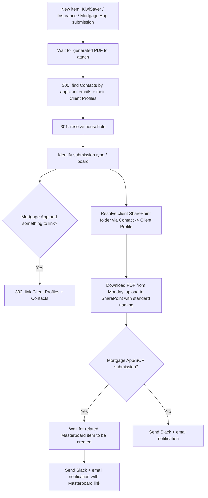

# AUTO-FORMS-001 — New Form Submission Filing

## 1. Purpose

File the generated PDF from a new KiwiSaver Questionnaire, Insurance Questionnaire or Mortgage App/SOP submission into the corresponding client's SharePoint folder, using a standardised naming convention, and notify the team via Slack and email so nobody has to manually check whether a new submission was filed.

## 2. Business context

RSFA collects KiwiSaver and Mortgage submissions via Superforms, and Insurance submissions via Monday Forms (`knowledge/01_RSFA_SYSTEM_MAP.md` §4.3, §9). Each submission type generates a PDF attached to the Monday item; this automation is responsible for getting that PDF into the client's document store reliably.

## 3. Scope

### Included

- Detecting a new item on the KiwiSaver Questionnaire, Insurance Questionnaire, or Mortgage App/SOP board.
- Waiting for the generated PDF to be attached to the item.
- Resolving the client's SharePoint folder via the related Contact → Client Profile relationship.
- Downloading and re-uploading the PDF using the naming convention `{{lastname}}_{{questionnaire_name}}_{{month}}{{year}}`.
- For Mortgage App/SOP submissions specifically, waiting for the corresponding Masterboard item to be created before notifying, and including a link to it.
- Slack and email notification once filing is complete.
- **Since 2026-11-05 — Mortgage App/SOP only:** resolving the applicants' household from their emails and linking the submission's `Client Profiles` (`board_relation_mm6fr9y4`) and `Contacts` (`board_relation_mkzqbtd0`) columns. See §10a.

### Excluded

- The Mortgage Application → Masterboard consolidation itself (`AUTO-MASTERBOARD-001`).
- Lead/Client Profile/Contact creation triggered by these same form submissions (`AUTO-LEADS-001`).

## 4. Current status

Active. **Modified 2026-11-05** (Mortgage App household linking, §10a) — confirmed from live system: blueprint saved via the Make API at `2026-11-05T20:50:45Z`, scenario active and valid, two live test submissions passed (§20). `High` criticality per `knowledge/03_AUTOMATION_REGISTRY.md` §3. One recent error recorded against this scenario in the Make inventory export — TODO: verify current error status.

## 5. Trigger

`M.com: New Form Submission in IQ/MA/KQ (Jun 2026)` (`9447215`): Webhook (custom webhook) — fires when a new item is created in `🐖 KiwiSaver Questionnaire`, `❓️Insurance Questionnaire`, or `✍ Mortgage App/SOP`.

## 6. Inputs

- New item on one of the three source boards, with its attached generated PDF.
- Related Contact(s) and their linked Client Profile, to resolve the client SharePoint folder.
- For Mortgage submissions: the corresponding item on `Masterboard: End Forms` (created by `AUTO-MASTERBOARD-001`).
- For Mortgage submissions (since 2026-11-05): the six applicant email columns of the webhook payload (`email_mkzd536s`, `email_mkzdatpd`, `email_mkzdc0kb`, `email_mkzdmm6e`, `email_mkzded9a`, `email_mkzdf02d`), matched against `Contacts` `Primary Email` (`contact_email`), `Alternative Email` (`email_mkxd41p7`) and `Second Alternative Email` (`email_mkxdantz`).

## 7. Outputs

- PDF filed to the client's SharePoint folder, named `{{lastname}}_{{questionnaire_name}}_{{month}}{{year}}`.
- Slack notification confirming filing (with a Masterboard link for Mortgage submissions).
- Email notification confirming filing.
- Mortgage App/SOP item (since 2026-11-05): `Client Profiles` (`board_relation_mm6fr9y4`) linked to the resolved Client Profile, and `Contacts` (`board_relation_mkzqbtd0`) set to that Client Profile's Contacts — only when the household is unambiguous (§10a).

## 8. Systems involved

Monday.com (KiwiSaver Questionnaire, Insurance Questionnaire, Mortgage App/SOP, Contacts, Client Profiles, Masterboard: End Forms), Make.com (execution), Microsoft SharePoint (destination), Microsoft Outlook/Email and Slack (notifications).

## 9. Related Monday boards

| Board | ID | Role |
|---|---|---|
| 🐖 KiwiSaver Questionnaire | `5026459551` | Trigger source |
| ❓️Insurance Questionnaire | `5025365501` | Trigger source |
| ✍ Mortgage App/SOP | `5025483251` | Trigger source; also requires waiting on the related Masterboard item |

## 10. Platform implementation

### Make.com scenarios

| Scenario ID | Exact Make name | Role | Status | Trigger | Calls | Called by | Source confidence |
|---|---|---|---|---|---|---|---|
| `9447215` | M.com: New Form Submission in IQ/MA/KQ (Jun 2026) | Parent | Active | Webhook (custom webhook) | `Outlook: Email Notification after Failed Scenario` (`8732008`) | None confirmed | Current — matches `source-material/make/M.com_ New Form Submission in IQ_MA_KQ (Jun 2026).md` exactly |

### Power Automate flows

Not applicable.

### Monday native automations or workflows

Not applicable, per available evidence.

### Native integrations

Superforms (KiwiSaver, Mortgage App/SOP) and Monday Forms (Insurance Questionnaire) write submissions directly into their respective boards, which then trigger this automation (`knowledge/03_AUTOMATION_REGISTRY.md` §7).

### Shared subflows and components

`COMP-MAKE-ERROR-001` — called on failure.

## 10a. Mortgage App household linking (added 2026-11-05)

**Status:** Confirmed from live system (blueprint re-read after save, 2026-11-05). Requested by RSFA on 2026-11-05 after it was confirmed that `Client Profiles` (`board_relation_mm6fr9y4`) on `✍ Mortgage App/SOP` was being filled manually (activity log: user Rod Schubert, hours to days after submission) and that no Monday automation or Make scenario wrote it.

**Design constraint:** no new scenario; reuse `9447215` and existing account patterns (GraphQL module, Code module as in `10083674`/`10093771`, household rule as in `10037840`).

### Modules added or changed

| Module | Type | What it does |
|---|---|---|
| `[300]` Find Contacts and Client Profile by Applicant Emails | `monday:ExecuteGraphQLQueryV2` (inline, after `[158]`) | One query: reads the submission's current `board_relation_mm6fr9y4` / `board_relation_mkzqbtd0`, and searches `Contacts` (`2074688484`) where any of the 6 applicant emails (trimmed; `__none__` placeholder when empty) equals `contact_email` OR `email_mkxd41p7` OR `email_mkxdantz`, returning each Contact's `Associated Client Profile` (`board_relation_mkxpzyfq`) and that profile's Contacts (`board_relation38`). Runs for all three boards; for KiwiSaver/Insurance it returns nothing (1 extra operation). On failure: error email + Resume (filing continues). |
| `[301]` Resolve household (household-resolver.js) | `code:ExecuteCode` | Decides what to write (rules below). Outputs IDs only. On failure: error email + Resume. Source is embedded in the blueprint export (§24). |
| `[143]` Get Contacts To Get Client Profiles | changed mapper | Contact ID fallback chain now ends in `301.result.firstContactId` before the dummy `1000000000`. |
| `[143]` / `[18]` error handlers | now a Router (`[310]` / `[320]`) | Route 1 — *Mortgage App submission with no matched Contact* / *no Client Profile*: `Resume` silently (expected case, **no error email**); the bundle continues to the existing "No Related Contacts found … no PDF" Slack/email notification. Route 2 — anything else (real failure, or KiwiSaver/Insurance): the original `Error Notification Email` + `Ignore`, unchanged. |
| `[302]` Link Client Profile and Contacts on Mortgage App | `monday:ExecuteGraphQLQueryV2`, new **first** route of router `[5]` | Filter: board `5025483251` AND `301.result.applies = true`. `change_multiple_column_values` on the submission with `301.result.columnValues`. On failure: error email + Resume. Runs ~20–25 s after item creation. |

### Household rules (`[301]`)

- **single** — every matched Contact that has a Client Profile points to the same one profile (Contacts without a profile are ignored): link `Client Profiles` = that profile, set `Contacts` = the profile's Contacts (`board_relation38`). `firstContactId` = a matched Contact of that profile.
- **ambiguous** — matched Contacts point to more than one Client Profile (including one Contact linked to two profiles): do **not** link a Client Profile; link only the matched Contacts if the Contacts column is empty. `firstContactId` = null (no automatic filing; the "No Related Contacts" notification is sent instead).
- **none** — no matched Contact has a profile, or nothing matched: link the matched Contacts if any (and if the column is empty); no profile; no error email.
- Never overwrites an already-linked Client Profile; never touches a non-empty Contacts column unless the household is single.

### Evidence for the rule (2026-11-05, live data, IDs only)

Simulated against all 32 existing submissions, using Rod's manual links as ground truth: **27 linked to the correct profile with exactly the Contacts Rod had linked, 2 skipped as ambiguous, 3 skipped (no email matched any Contact), 0 wrong links.** Email matching in Monday `any_of` is case-insensitive but whitespace-sensitive (hence `trim()`).

### Interaction with other automations (confirmed from live blueprints, 2026-11-05)

| Automation | Effect |
|---|---|
| 4 native Monday automations on `5025483251` ("When an item is created, connect … email matches Primary Email in Contacts", recipe 229, IDs `26275513`, `26275581`, `26275626`, `26275700`) | **Deleted by RSFA on 2026-11-05** (confirmed live). `[302]` is now the only writer of `Contacts` on new submissions; Contacts appear ~20–25 s after creation instead of ~5 s. |
| `8410524` Mortgage App → Masterboard (`AUTO-MASTERBOARD-001`) | Independent: does its own Contact search via subflow `8518416`, **updates the matched Contact** (`[485]`) and **renames the Mortgage App item to the Contact's Client Profile name** (`[491]`). Only runs when `1st App First Name` is present. Does not read or write `board_relation_mm6fr9y4` / `board_relation_mkzqbtd0`. |
| `10083674` Related Assets Renaming after Client Profile Rename (Nov 2026) | When a Client Profile is renamed, renames Mortgage App items whose `board_relation_mm6fr9y4` holds exactly that profile. Automatic linking therefore extends this cascade to new submissions (intended). Linking itself does not trigger it. |
| `9555578` Branded SOP Filling and Filing (`AUTO-BRANDED-SOP-001`) | Reads the first Contact in `board_relation_mkzqbtd0` to reach the profile/SharePoint folder; with Contacts taken from the profile this resolves to the same profile. |
| `10037840` End Forms: Client Profile link and record name sync | Works on `Masterboard: End Forms` (`5026186805`) only; unaffected. |
| `10093771` Client Profile Name from Contacts (Nov 2026) | Triggers on Client Profile Contacts changes; `[302]` does not change a profile's Contacts. Unaffected. |
| `Client Profiles` column `Mortgage App/SOP` (`board_relation_mm6fn506`) | Not the reflection of `board_relation_mm6fr9y4` (one-way columns); it is **not** filled by this change. |

## 11. End-to-end process

## 12. Data mapping

| Source field | Destination | Notes |
|---|---|---|
| Applicant last name | Filename component | `{{lastname}}` |
| Board/questionnaire type | Filename component | `{{questionnaire_name}}` |
| Submission month/year | Filename component | `{{month}}{{year}}` |
| Related Contact -> Client Profile -> SP folder | Upload destination | — |
| Mortgage App applicant emails (6 columns) → `Contacts` (`contact_email`, `email_mkxd41p7`, `email_mkxdantz`) | Matched Contacts | Since 2026-11-05, `[300]` |
| Single household's Client Profile ID | `✍ Mortgage App/SOP` `Client Profiles` (`board_relation_mm6fr9y4`) | Since 2026-11-05, `[302]`; only if empty |
| That Client Profile's `Contacts` (`board_relation38`) | `✍ Mortgage App/SOP` `Contacts` (`board_relation_mkzqbtd0`) | Since 2026-11-05, `[302]` |

## 13. Decision and routing logic

- The flow branches by which of the three boards triggered it, to select the correct naming/notification path.
- For Mortgage App/SOP submissions only, the flow waits for the Masterboard item (created asynchronously by `AUTO-MASTERBOARD-001`) before sending its notification, so the notification can include a working Masterboard link.

## 14. Dependencies

- Client's SharePoint folder must already exist (`AUTO-SP-FOLDER-001`).
- For Mortgage submissions, depends on `AUTO-MASTERBOARD-001` completing in a timely manner; a slow or failed Masterboard creation could delay or affect this automation's notification step.

## 15. Error handling

Calls `COMP-MAKE-ERROR-001` on failure.

Since 2026-11-05: for Mortgage App submissions, "no Contact matched" (`[143]`) and "Contact has no Client Profile" (`[18]`) are treated as expected outcomes, not errors — the bundle resumes silently and the existing "No Related Contacts found … Unable to access Client's folder" Slack/email notification is sent instead of `COMP-MAKE-ERROR-001`. Real module failures (an ID was available but the read failed, or any failure on KiwiSaver/Insurance) still send `COMP-MAKE-ERROR-001`. `[300]`, `[301]` and `[302]` send `COMP-MAKE-ERROR-001` and Resume, so a linking failure never blocks PDF filing.

## 16. Logging and observability

Slack and email notifications serve as the operational confirmation log for each filed submission. No dedicated Monday board log confirmed.

## 17. Manual operations and reprocessing

Not confirmed. TODO: verify whether a submission that failed to file (e.g. PDF never generated) can be manually re-triggered.

## 18. Known limitations

- Depends on the source board's PDF-generation step completing before this automation's wait step times out — TODO: verify the wait step's timeout behaviour if the PDF is delayed or never generated.
- One recent error recorded in the last Make inventory export — root cause not investigated in this pass.
- Household linking (§10a) depends on applicant emails matching an existing Contact's Primary/Alternative/Second Alternative email; typos or new emails leave the columns for manual linking (3 of 32 historical submissions).
- Ambiguous households (a matched Contact linked to two profiles, or duplicate Contacts on different profiles) are deliberately not linked and not auto-filed (2 of 32 historical submissions).
- `[158]` still finds the submission by **item name** (pre-existing behaviour); `[300]` reads the submission by item ID and `[302]` writes by item ID, so the new linking does not depend on that name search.
- Contacts order in `board_relation_mkzqbtd0` follows the Client Profile's order, not 1st/2nd applicant order.

## 19. Security and sensitive data

Filed PDFs contain client financial, insurance or KiwiSaver personal data. Never use real client submissions as test data; use fictional test submissions only.

## 20. Testing

### Confirmed tests

Live tests on 2026-11-05, with the existing test household `Leo Test 15 & leotest 14` (Client Profile `2519813525`, Contacts `2654537673`, `2654609722`). `1st App First Name` was left empty on purpose so `8410524` would not run (no Masterboard item, no Contact update). Both test items were deleted afterwards (`2900377048`, `2900378393`, state `deleted`); the board returned to 32 items and the test Client Profile was unchanged.

| Test | Result | Evidence |
|---|---|---|
| Two-applicant submission, both emails match Contacts of one profile | **Passed** | Execution `5c88bbc4a641418981f2e0da7e516576`: SUCCESS, 13 operations (was 10–11), 89 s. Activity log: `board_relation_mm6fr9y4` = `2519813525` written by the Make connection user at 20:52:38Z (~23 s after creation). `Contacts` had already been linked by the native automations (user `-4`) at +5 s; `[301]` did not rewrite them (same set). |
| Submission whose email matches no Contact | **Passed** | Execution `1c2e924ab38e4c598ffa4a945d850530`: SUCCESS, 12 operations, 83 s. `Outlook: Email Notification after Failed Scenario` (`8732008`) did not run. Item left untouched. Slack `#1_mortgage_finance_automations` received the existing "No Related Contacts found … no PDF" notification. |
| `8410524` not triggered without first name | **Passed** | `8410524` executions: 1 operation each, no Masterboard item created. |
| Contacts written by `[302]` with native automations removed | **Passed** | After RSFA deleted the 4 native automations (confirmed live: none left on the board). Execution `bc981c6bbbb24704a53b9e85f899bfd4`: SUCCESS, 13 operations, 93 s. Activity log: `Client Profiles` = `2519813525` at 21:00:06.0Z and `Contacts` = `2654537673`, `2654609722` at 21:00:06.7Z, both by the Make connection user (~24 s after creation); no automation-user (`-4`) writes; `8732008` not called. Test item `2900412710` deleted. |
| Ambiguous household / profile already linked / KiwiSaver & Insurance unchanged | **Partially verified** | Unit-tested against the 32 historical cases and edge cases (offline, `node`); not exercised live. |

### Required regression tests

- New KiwiSaver Questionnaire submission → PDF filed with correct naming, notifications sent.
- New Insurance Questionnaire submission → PDF filed with correct naming, notifications sent.
- New Mortgage App/SOP submission → PDF filed, notification waits for and includes the Masterboard link.
- PDF not yet generated at trigger time → confirm the wait behaviour (does not fail prematurely).

### Test data restrictions

Use fictional applicant data and test submissions only.

## 21. Validation after change

Submit a test item to each of the three source boards, confirm the PDF is correctly named and filed to the expected test SharePoint location, and confirm Slack/email notifications fire — including the Masterboard link for the Mortgage App/SOP case.

## 22. Rollback

Disable the `M.com: New Form Submission in IQ/MA/KQ (Jun 2026)` scenario. No automated rollback of already-filed PDFs is defined.

To roll back only the 2026-11-05 household linking: restore the previous scenario version in Make's version history (saved before `2026-11-05T20:50:45Z`; last edit before that was `2026-10-25T15:08:59Z`), or delete route `[302]`, modules `[300]`/`[301]`, restore `[143]`'s mapper (remove `ifempty(301.result.firstContactId; …)`) and restore the `[143]`/`[18]` error handlers to `Error Notification Email` + `Ignore`. If the native "connect by email" automations were deactivated, re-activate them at the same time.

## 23. Troubleshooting guide

1. Confirm the source board item actually has the generated PDF attached.
2. Confirm the related Contact/Client Profile resolves to a valid SharePoint folder.
3. For Mortgage App/SOP submissions, confirm the corresponding Masterboard item exists (see `AUTO-MASTERBOARD-001`) if the notification appears stuck.
4. Check for `COMP-MAKE-ERROR-001` failure emails.

## 24. Source references

- `source-material/make/M.com_ New Form Submission in IQ_MA_KQ (Jun 2026).md` — Current. Exact match to the registered scenario.
- `exports/make/valid-scenarios-working-inventory.md`, `exports/make/make-scenario-call-graph.md` — Current. Scenario ID, trigger, recent-error count.
- `knowledge/03_AUTOMATION_REGISTRY.md` §3, §7 — Current. Canonical ID and native-integration relationships.
- `knowledge/01_RSFA_SYSTEM_MAP.md` §9 — Current. Form/end-form data flow context.
- `exports/make/blueprints/9447215-new-form-submission-iq-ma-kq.blueprint.json` — live blueprint after the 2026-11-05 change, read back from the Make API; Make UI sample data and module interface metadata removed, no functional content removed. Contains the `[301]` resolver source.
- Live Monday API reads, 2026-11-05 — board `5025483251` column `board_relation_mm6fr9y4` (`Client Profiles`, one-way link to `5024661649`); native automations list; activity logs of the two most recent submissions; links/emails of all 32 submissions (used only in-session for the simulation; no client data stored here).
- Live Make blueprints, 2026-11-05 — `8410524`, `9555578`, `10083674`, `10037840`, `10093771`, `9711585`, `1054927`, `8518416`, `8731317`, `8800779`, `6238398`, `8890068`, `9911348`.

## 25. Known gaps

- Wait-step timeout behaviour if a PDF is delayed or never generated is unconfirmed.
- Manual reprocessing procedure for a failed filing is unconfirmed.
- Root cause of the one recorded recent error is not investigated.
- Make's execution-detail API returned only the status for the 2026-11-05 test runs; per-module outputs of `[300]`/`[301]` were verified indirectly (Monday activity log, operation counts, Slack).

## 26. Change history

| Date | Change | Author |
|---|---|---|
| 2026-07-30 | Initial canonical documentation created from registry and source-material evidence. | Claude (documentation task) |
| 2026-11-05 | Documented the household-linking change made to `9447215` (approved by RSFA): modules `[300]`/`[301]`/`[302]`, `[143]` fallback, silent handling of "no Contact / no Client Profile" for Mortgage App, interactions with `8410524`, `10083674`, `9555578` and the native email-matching automations; recorded live test results and rollback. Added sanitized blueprint export. | Claude (change + documentation task) |
