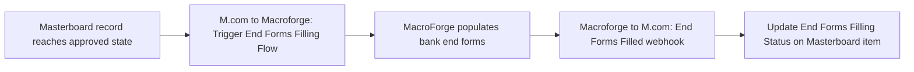

# AUTO-MACROFORGE-001 — MacroForge End-Forms Integration

## 1. Purpose

Trigger MacroForge's automated bank end-form population from an approved `Masterboard: End Forms` record, and record the completion status back into Monday.com once MacroForge has filled the forms, so advisers know when a client's bank end forms are ready without checking MacroForge directly.

## 2. Business context

MacroForge is a desktop tool that reads `Masterboard: End Forms` to populate bank end forms automatically (`knowledge/01_RSFA_SYSTEM_MAP.md` §4.4, `knowledge/02_SYSTEMS_REGISTRY.md` SYS-MACROFORGE-001). This automation is the trigger/completion bridge between Monday.com and MacroForge, and depends entirely on `AUTO-MASTERBOARD-001` having already produced a current, complete Masterboard record.

## 3. Scope

### Included

- Triggering the MacroForge end-forms filling process from an approved Monday data state.
- Receiving MacroForge's completion callback and recording it against the originating Masterboard item.

### Excluded

- Populating or consolidating the Masterboard dataset itself (`AUTO-MASTERBOARD-001`).
- MacroForge's own local/desktop synchronisation behaviour (documented, if at all, under `knowledge/systems/macroforge/`).

## 4. Current status

Active. `Critical` per `knowledge/03_AUTOMATION_REGISTRY.md` §3. One recent error is recorded against scenario `8731317` in the Make inventory export (`exports/make/valid-scenarios-working-inventory.md`) — TODO: verify current error status.

## 5. Trigger

- `M.com to Macroforge: Trigger Macroforge End Forms Filling Flow (Feb 2026)` (`8731317`): Monday.com watch `monday:watchBoardColumnValuesV2` (hook `3905270`) on board `5026186805`, `updateType: change_specific_column_value`, column `status` (`End Forms Filling Status`). **No label value is configured**, so the scenario fires on *any* change to `status`, although the module label says "End Forms Filling Status Reviewed". *Confirmed from live system (read-only blueprint and hook config, 2026-10-27).*
- `Macroforge to M.com: End Forms Filled (May 2026)` (`9254149`): custom webhook (hook `4136771`, label `Macroforge-Filled-End-Forms`). It fires when MacroForge's "Send to Zapier/Make" node calls back. *Confirmed from live system (read-only, 2026-10-27).*
- Re-trigger risk: hook `3905270` has no value or previous-value filter, no module filters, and no module reads the label. So a `Filled` write by `9254149` *can* re-run `8731317` and POST to MacroForge again, if Monday emits the event. *Confirmed from live system (read-only, 2026-10-27).* Make returned only one execution pair (`8731317` 2026-10-01 23:16:43Z, then `9254149` 23:17:09Z), and **no re-trigger followed it**. *Partially verified: 1 sample, run details not retrievable.* TODO: verify with the Monday activity log for `status` around that time. A proposed guard is a filter after module 1 allowing only the intended label. That is a production change requiring a change plan and approval, and it was not made.

## 6. Inputs

- `8731317` posts a JSON body composed in module 6. The top-level keys are `userId`, `id`, `name`, `email`, `created_at`, `updated_at`, `state`, `board.id`, `creator_id`, `group.{id,title,deleted,archived}`, `formatted_created_at`, `formatted_updated_at` and `result`. The `result` object is built by JavaScript module 8, as follows. *Confirmed from live system (read-only, 2026-10-27).*
  - Keys are Monday **column titles**, not column IDs. Values are the column `.text`, a boolean for checkbox columns, or `DDMMYYYY` for date columns.
  - Columns that share a title are merged into arrays. Seven titles are affected, e.g. `Loan processing fee` and `Cash contribution`.
  - Derived keys are added: `<field> Day|Month|Year` for 6 date fields, and `<field> Street|Suburb|City|Province|Postcode|Country` for 10 address fields. The address parts come from an OpenAI `gpt-4o-mini` module (26).
  - `Subitems` is an array of `{name, values}`.
- `9254149` receives the MacroForge callback, which echoes the payload keys flattened (`/` and `.` become `_`). **Only `id` is used.** *Confirmed from live system (read-only, 2026-10-27).*
- The HTTP response `200 {"status":"routed","success":true}` from the MacroForge endpoint confirms dispatch only, not completion.

## 7. Outputs

- Payload sent to MacroForge to initiate end-forms population (mechanism: HTTP/Custom API and/or a Google Cloud function, plus OpenAI per the scenario's listed systems — exact roles not confirmed).
- Completion status recorded back onto the Masterboard item: `9254149` sets `status` (`End Forms Filling Status`) to the label `Filled`. Other labels are `Reviewed`, `Reviewing` and `Cancelled`. *Confirmed from live system (read-only, 2026-10-27).* No file, PDF or success/failure detail is returned to Make.

## 8. Systems involved

Monday.com (trigger + completion record), Make.com (execution), MacroForge (end-form population), Google Cloud (custom function calls — per the scenario's listed system "code" and "HTTP / Custom API"), OpenAI/GPT (role in this scenario not confirmed from available evidence — TODO: verify).

## 9. Related Monday boards

| Board | ID | Role |
|---|---|---|
| Masterboard: End Forms | `5026186805` | Source of the trigger data and destination for the completion status (`End Forms Filling Status` column) |

## 10. Platform implementation

### Make.com scenarios

| Scenario ID | Exact Make name | Role | Status | Trigger | Calls | Called by | Source confidence |
|---|---|---|---|---|---|---|---|
| `8731317` | M.com to Macroforge: Trigger Macroforge End Forms Filling Flow (Feb 2026) | Parent | Active | Monday.com instant trigger (watch) | `Outlook: Email Notification after Failed Scenario` (`8732008`) | None confirmed | Current (registry + call graph); no dedicated source-material walkthrough |
| `9254149` | Macroforge to M.com: End Forms Filled (May 2026) | Standalone | Active | Webhook (custom webhook) | None confirmed | None confirmed | Current (registry + call graph); no dedicated source-material walkthrough |

No `source-material/make/` file exists for either scenario in this family — all implementation detail beyond name/trigger/status is inferred from the registry and call-graph exports only.

### Power Automate flows

Not applicable.

### Monday native automations or workflows

Not applicable, per available evidence.

### Native integrations

Not applicable — MacroForge is invoked via Make.com, not a native Monday integration.

### Shared subflows and components

`COMP-MAKE-ERROR-001` — called by scenario `8731317`.

## 11. End-to-end process

## 12. Data mapping

TODO: complete mapping from current production configuration. No field-level payload structure is confirmed from available evidence for either the trigger or the completion webhook.

## 13. Decision and routing logic

- Make performs **no lender/template routing**. It sends `Banks to Send` (`dropdown_mkzvfgeg`) as text. The only branching in Make picks one of three MacroForge webhook URLs by `userId`, and all three currently hold the same value. *Confirmed from live system (read-only, 2026-10-27).*
- In MacroForge (`.mforge` export `RSFA End Forms Filling BluePrint 271026`, inspected 2026-10-27), `Flow C` routes on `Banks to Send Contains ASB | KiwiBank | WBC | ANZ | BNZ` to 6 PDF batch fillers (25 templates, 1,013 field mappings), plus `All Banks_DOAD.pdf` for every run. *Historical information (point-in-time export).* The full inventory is in the `rsfa-end-forms-engine` repository, `docs/03-migration-inventory.md`.

## 14. Dependencies

- Depends on `AUTO-MASTERBOARD-001` having already produced a complete, current Masterboard record.
- Depends on MacroForge's desktop application being able to reach the Masterboard data and complete its local processing before calling back.

## 15. Error handling

*Confirmed from live system (read-only, 2026-10-27):*
- `8731317`:
  - Get Item (4) and HTTP (3) use `Break` with 3 retries every 5 minutes, and the incomplete-executions queue is enabled.
  - Address lookup (20) uses `Ignore`.
  - OpenAI (26) uses `Resume` with `{}`, so address parts are silently missing and no alert is sent.
  - A Code (8) failure calls `COMP-MAKE-ERROR-001` (`8732008`).
  - Non-2xx MacroForge responses get no handling beyond the retries.
- `9254149`: a module 2 error calls `COMP-MAKE-ERROR-001`, then `Ignore`.

## 16. Logging and observability

The `End Forms Filling Status` column on the Masterboard item is the primary observability signal. No dedicated error/health board confirmed for this specific automation.

## 17. Manual operations and reprocessing

Not confirmed. TODO: verify whether a stalled or failed MacroForge run can be manually re-triggered from Monday, or requires direct MacroForge desktop intervention.

## 18. Known limitations

- One recent error recorded against scenario `8731317` in the last Make inventory export — root cause not investigated in this pass.
- The trigger has no label filter (see §5), so any `status` change, including `Filled`, sends the record to MacroForge.
- The payload contract depends on Monday column **titles**. Renaming a column changes the keys MacroForge receives, and the mapping silently stops matching.
- The JSON body is composed as a string template. Inference: a `"` in an item or group name would produce invalid JSON.

## 19. Security and sensitive data

Masterboard data sent to MacroForge includes extensive client financial and personal information. Never trigger this automation against real client data for testing; use a dedicated test Masterboard item.

Findings from the 2026-10-27 read-only review (no changes made; any fix is a production change requiring approval):
- Unconnected test modules 43 and 44 in `8731317` store a full real-looking client payload and the MacroForge webhook URL.
- The MacroForge webhook URLs are hard-coded in module 13, and the HTTP call uses no authentication.
- Every run sends client address text to OpenAI (`gpt-4o-mini`).
- The MacroForge `.mforge` export contains a real client `sample_payload` and the callback webhook URL. Store it only in an approved private location, never in a repository.

## 20. Testing

### Confirmed tests

None recorded.

### Required regression tests

- Approved test Masterboard item → MacroForge trigger fires correctly.
- MacroForge completion webhook → `End Forms Filling Status` updates correctly on the originating item.
- Failure during triggering → `COMP-MAKE-ERROR-001` notification fires.

### Test data restrictions

Use a dedicated test Masterboard item with fictional applicant data only.

## 21. Validation after change

Move a test Masterboard item into the state that triggers scenario `8731317`, confirm MacroForge receives the trigger (via MacroForge-side confirmation, not just Make.com "success"), and confirm the completion webhook correctly updates the test item's status.

## 22. Rollback

Disable the affected Make.com scenario. No automated rollback of MacroForge-side document generation is defined.

## 23. Troubleshooting guide

1. Confirm the Masterboard item actually reached the state expected to trigger scenario `8731317`.
2. Check for `COMP-MAKE-ERROR-001` failure emails.
3. If MacroForge ran but the status never updated in Monday, check whether the completion webhook (`9254149`) fired and whether it targeted the correct item.
4. Check the Make inventory export for recent-error counts on either scenario.

## 24. Source references

- `exports/make/valid-scenarios-working-inventory.md`, `exports/make/make-scenario-call-graph.md` — Current. Scenario IDs, trigger types, systems, recent-error count.
- `knowledge/03_AUTOMATION_REGISTRY.md` §3, §4 — Current. Canonical ID, family grouping.
- `knowledge/01_RSFA_SYSTEM_MAP.md` §4.4 — Current. MacroForge's role and data source.
- `knowledge/02_SYSTEMS_REGISTRY.md` SYS-MACROFORGE-001 — Current. Platform description.
- `knowledge/04_MONDAY_BOARDS_REGISTRY.md` — Current. Masterboard key columns including `End Forms Filling Status`.
- No `source-material/make/` file exists for either scenario in this family.
- Live Make blueprints of `8731317` and `9254149`, and hook `3905270` configuration — read-only retrieval 2026-10-27 via the Make connector. Current at that date.
- MacroForge export `RSFA End Forms Filling BluePrint 271026.mforge` (SHA-256 `8052c17b…797c`) — point-in-time export, kept outside git; summarised in `rsfa-end-forms-engine/docs/03-migration-inventory.md`.

## 25. Known gaps

- Trigger, payload structure and the OpenAI role were confirmed on 2026-10-27 (read-only). Whether `Filled` re-triggers `8731317` is still unconfirmed (execution history not reviewed).
- The Make blueprint's cached column list appears older than the live board. 11 titles used by MacroForge mappings (e.g. `Applicant 1 Full Name`) are absent from it. TODO: verify against the live board columns.
- Manual reprocessing procedure for a stalled MacroForge run is unconfirmed.
- MacroForge's own local/SharePoint/OneDrive synchronisation behaviour (`knowledge/01_RSFA_SYSTEM_MAP.md` §19 known gap) remains undocumented and is out of scope for this file.

## 26. Change history

| Date | Change | Author |
|---|---|---|
| 2026-07-30 | Initial canonical documentation created from registry and call-graph evidence only; no source-material walkthrough available. | Claude (documentation task) |
| 2026-10-27 | Re-trigger risk reviewed with read-only execution history (1 pair, no re-trigger observed); guard proposed, not implemented. | Claude (end-forms engine iteration 2) |
| 2026-10-27 | Added trigger, payload contract, routing, error handling and security findings from a read-only review of the live `8731317`/`9254149` blueprints and hook `3905270`, plus MacroForge `.mforge` structure. Replacement-engine work tracked in repository `rsfa-end-forms-engine`. No production change made. | Claude (end-forms engine POC) |
