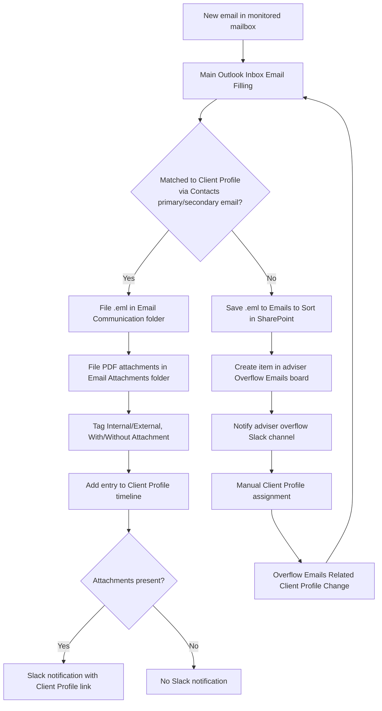

# AUTO-EMAIL-001 — Client Email Filing and Overflow Processing

## 1. Purpose

Automatically file incoming and outgoing adviser emails against the correct Client Profile in SharePoint and Monday.com, so email evidence, attachments and client activity history are captured without an adviser manually saving or forwarding anything. Emails that cannot be confidently matched to a client are routed to a human-reviewed overflow queue instead of being silently dropped or misfiled.

## 2. Business context

RSFA advisers correspond with clients almost entirely through Outlook (mailboxes for Rod, Kathleen, Seth, Jet and the shared `support` mailbox). Client folders in SharePoint and the Client Profile's activity timeline are the operational record of that correspondence. Reliable filing depends on matching the email's sender/recipient address to a Client Profile via the Contacts board's Primary/Secondary email columns.

## 3. Scope

### Included

- Monitoring of the Sent (and, per mailbox flow name, Received) folders of the mailboxes: Rod, Kathleen, Seth, Jet, the `support` shared mailbox, and — per RSFA report, 2026-08-04 — the `it-support` shared mailbox.
- Matching an email to a Client Profile via Contacts primary/secondary email columns.
- Filing the `.eml` file and PDF/attachment copies into the client's SharePoint folder.
- Adding processed emails to the Client Profile's Emails & Activities timeline.
- Classifying emails as Internal/External and With/Without Attachment.
- Slack notification when a client document arrives.
- Routing of unmatched emails to an adviser-specific Overflow Emails board and Slack channel, and reprocessing once a human assigns a Client Profile.

### Excluded

- Full mailbox backup and disaster recovery (`AUTO-EMAIL-BACKUP-001`).
- SharePoint client-folder creation, renaming and permissions (`AUTO-SP-FOLDER-001`).
- DocuSign envelope filing (`AUTO-DOCUSIGN-001`).

## 4. Current status

Active for Rod, Kathleen, Seth and Support mailboxes. The two Jet-related flows (`Outlook Email Filing - Jet v2`, `OLD Outlook SENT Email Filling - Jet v2`) are `Active - Planned Retirement` and are expected to be removed together with the Jet overflow board when Jet leaves RSFA (per `knowledge/01_RSFA_SYSTEM_MAP.md` §15 and §4.3). Per RSFA report (2026-08-04), the `it-support@rsfa.co.nz` mailbox is now also active in this flow family — TODO: confirm the exact new flow name(s) against a Power Automate export or live portal, none exist yet. The planned addition for `leo@rsfa.co.nz` remains not active — TODO: verify.

## 5. Trigger

New email detected in a monitored mailbox's Sent folder (per the source-material walkthrough) or Received folder (inferred from mailbox-specific "Email Filing" flow names, not separately walked through in source material — TODO: verify Received-side step detail). The central `Main Outlook Inbox Email Filling` flow is invoked as a child flow from each mailbox-specific flow.

## 6. Inputs

- Email message: sender, To/CC/BCC recipients, subject, timestamp, attachments.
- Monday.com Contacts board: Primary Email and Secondary/Alternate Email columns, linked Client Profile.
- Monday.com Client Profiles board: `SP folder` link.
- SharePoint: existence check for an already-filed `.eml` with the same identity, to avoid duplicate filing.

## 7. Outputs

- `.eml` file saved under the client's SharePoint folder, in the `f. Email Communication` subfolder.
- PDF attachments saved under the `g. Email Attachments` subfolder, tagged Internal/External and With/Without Attachment.
- Client Profile Emails & Activities timeline entry.
- Slack notification when a new attachment is filed, posted to a per-mailbox channel following the `{mailbox}_ai_emails` naming pattern (confirmed in the 2026-07-30 export: `rod_ai_emails`, `kathleen_ai_emails`, `seth_ai_emails`, `jet_ai_emails`, `leo_ai_emails`). Per RSFA report (2026-08-04), `it_support_ai_emails` and `support_ai_emails` channels were added, extending this pattern to the `it-support` and `support` mailboxes — not yet independently confirmed in a Power Automate export.
- For unmatched emails: an item created in the relevant adviser's Overflow Emails board, plus a Slack message in the adviser's overflow channel.
- For failed filing attempts: an email to `tech@rsfa.co.nz` (subject `Failed Item Email Filing`, per RSFA report) for later reprocessing via `Email Filling Failed Items Processing` (`AUTO-EMAIL-BACKUP-001`), and a Slack notification to the shared `fails_ai_emails` channel — see §15.
- An execution record for the flow run, written to the Monday.com `Power Automate Runs` board (`5030408927`) — see §9 and §16.

## 8. Systems involved

Outlook (source), Power Automate (execution), Monday.com (Contacts / Client Profiles / Overflow Emails boards), SharePoint (client folder storage), Slack (notifications), Real Savvy Ref Outlook Add-in (lets advisers force a match via the `RSFA Ref %ClientProfileID%` subject convention — per `knowledge/02_SYSTEMS_REGISTRY.md` SYS-RSFA-REF-001).

## 9. Related Monday boards

| Board | ID | Role |
|---|---|---|
| Client Profiles | `5024661649` | Match target; source of the SharePoint folder link |
| Contacts | `2074688484` | Primary/Secondary email lookup |
| 📬 Overflow Emails - Rod/Kathleen | `5029313286` | Unmatched-email queue for Rod and Kathleen |
| 📬 Overflow Emails - Seth | `5029313272` | Unmatched-email queue for Seth |
| 📬 Overflow Emails - Jet | `5029313274` | Unmatched-email queue for Jet (planned retirement) |
| 📬 Overflow Emails (OLD) | `5025365487` | Historical/legacy overflow board — TODO: verify current use |
| ⚡ Power Automate Runs | `5030408927` | Execution log board. **Confirmed live 2026-09-05**: public access, 13,217 items, 10 columns including `Developer Notes` and a `Reprocessed` status label not previously documented — see §16 |

## 10. Platform implementation

### Make.com scenarios

Not applicable. This automation runs entirely on Power Automate.

### Power Automate flows

| Exact flow name | Flow type | Role | Current status | Source confidence |
|---|---|---|---|---|
| Main Outlook Inbox Email Filling | Instant child flow | Central reusable filing logic (matching, filing, tagging, timeline, Slack) | Active | Confirmed from export — `RSFAOutlookEmailFilling` Solution export (2026-07-30), workflow ID `f6906da4-c8ed-ef11-9341-6045bd3ce9ae`, Activated, HTTP-Request child-flow trigger. Matches source-material walkthrough closely, though the source-material file is titled "Outlook Email Filing to SharePoint" |
| Outlook Email Filing - Support v2 | Automated | Mailbox-specific caller for `support` mailbox | Active | Confirmed from export — workflow ID `ca963563-abfb-ef11-bae3-6045bd4096fa`, Activated |
| Outlook Email Filing - Seth v2 | Automated | Mailbox-specific caller | Active | Current (registry only) — absent from the 2026-07-30 `RSFAOutlookEmailFilling` export; not resolved as missing-from-export vs. registry-stale |
| Outlook SENT Email Filling - Seth v2 | Automated | Sent-folder caller for Seth | Active | Current (registry only) — same gap as above |
| Outlook Email Filing - Kathleen v2 | Automated | Mailbox-specific caller | Active | Likely mapping — export contains `"Outlook Email Filling - Kathleen v2"` (workflow ID `360d1f29-5bf8-ef11-bae2-002248185f06`, Activated); registry spells it "Filing", export spells it "Filling". Not silently corrected — see `exports/power-automate/solutions/rsfa-outlook-email-filing/manifest.md` |
| Outlook SENT Email Filling - Kathleen v2 | Automated | Sent-folder caller for Kathleen | Active | Confirmed from export — workflow ID `5d50f6af-affa-ef11-bae2-6045bd4096fa`, Activated |
| Outlook Email Filing - Rod v2 | Automated | Mailbox-specific caller | Active | Likely mapping — export contains `"Outlook Email Filling - Rod v2"` (workflow ID `d34b8f51-46f8-ef11-bae2-002248185f06`, Activated); same "Filing" vs "Filling" spelling conflict as Kathleen's flow above |
| Outlook SENT Email Filling - Rod v2 | Automated | Sent-folder caller for Rod | Active | Confirmed from export — workflow ID `d2d40c71-dbf9-ef11-bae2-6045bd4096fa`, Activated |
| Outlook Email Filing - Jet v2 | Automated | Mailbox-specific caller | Active - Planned Retirement | Likely mapping — export contains `"Outlook Email Filling - Jet v2"` (workflow ID `d30599eb-ec37-f011-8c4d-6045bd4096fa`, Activated); same spelling conflict |
| OLD Outlook SENT Email Filling - Jet v2 | Automated | Sent-folder caller for Jet | Active - Planned Retirement | Confirmed from export — exact name match, workflow ID `80273d77-b79c-f011-bbd2-000d3ae0ae9d`, Activated |
| Overflow Emails Contact Matching | Instant | AI-suggested Client Profile match for overflow items | Active | Confirmed from export — workflow ID `6bf7b40c-b29c-f011-bbd2-000d3ae0ae9d`, Activated, HTTP-Request trigger; implementation detail beyond trigger/name still TODO: verify |
| Overflow Emails Suggested Match Approval | Automated | Human approval gate for AI-suggested match | Active | Current (registry only) — **absent from the 2026-07-30 `RSFAOutlookEmailFilling` export entirely**. Not resolved: either this flow lives in a different, not-yet-exported Solution, or it has been removed/renamed since the registry entry was written |
| Overflow Emails Related Client Profile Change | Automated | Reprocesses an email once a Client Profile is manually assigned | Active | Confirmed from export — workflow ID `03b8f6d7-66af-f011-bbd3-000d3ae0ae9d`, Activated, HTTP-Request trigger |

**Additional flows found in the 2026-07-30 export with no current registry entry** (not silently mapped to any of the above — see `exports/power-automate/solutions/rsfa-outlook-email-filing/manifest.md` for full detail):

| Exact flow name (export) | Workflow ID | State (export) | Trigger (export) | Notes |
|---|---|---|---|---|
| Outlook INBOX items email filing (Rod) | `921a3139-e5da-ef11-8eea-00224814e0ff` | Draft (not activated) | `When_a_new_email_arrives_(V3)` | Distinct from the registered `Outlook Email Filing - Rod v2`; purpose relative to it unconfirmed |
| Outlook INBOX items email filing (Kathleen) | `941a3139-e5da-ef11-8eea-00224814e0ff` | Draft (not activated) | `When_a_new_email_arrives_(V3)` | Distinct from the registered `Outlook Email Filing - Kathleen v2`; purpose relative to it unconfirmed |
| Sent Emails Control | `32f10b1d-b79c-f011-bbd2-000d3ae0ae9d` | Draft (not activated) | HTTP Request | No registry equivalent found under any name |
| Outlook SENT Email Filling - Support v2 | `816b9f65-6237-f011-8c4d-6045bd4096fa` | Draft (not activated) | `When_a_new_email_arrives_in_a_shared_mailbox_(V2)` | Registry has no SENT-side flow for the `support` mailbox; this may be a work-in-progress addition |

**New mailbox discovered in export — not in this document's monitored-mailbox list (§4):** the `RSFAOutlookEmailFilling` Solution's connection references include `rsfa_sharedoffice365_326a9`, display name `Outlook_Insurance_RSFA`. `knowledge/06_NAMING_AND_ID_CONVENTIONS.md` §16 confirms `insurance@rsfa.co.nz` as a known RSFA account, but no flow in this export was confirmed to use this specific connection reference in this inspection pass, and §4 below still lists only Rod, Kathleen, Seth, Jet and Support. **Not silently added to §4 — flagged here for live verification.**

Note: `knowledge/03_AUTOMATION_REGISTRY.md` §5 lists the exact flow names above as the current inventory. `source-material/power-automate/Outlook Email Filing to SharePoint.md` describes matching/filing logic in detail but does not use these exact flow names — treat the source-material walkthrough as **historical/partial** evidence of the filing logic, not as confirmation of current flow names. TODO: verify the source-material walkthrough still matches the current `Main Outlook Inbox Email Filling` implementation.

### Monday native automations or workflows

Not applicable — Monday's role here is as a data source (Contacts, Client Profiles) and as the destination for overflow items, not as the automation engine.

### Native integrations

Real Savvy Ref Outlook Add-in lets an adviser copy a Client Profile ID into the email subject (`RSFA Ref %ClientProfileID%`), forcing a match regardless of address-based matching.

### Shared subflows and components

None confirmed for this automation family in the current Make/Power Automate exports.

## 11. End-to-end process

## 12. Data mapping

| Source field | Destination | Notes |
|---|---|---|
| Email sender/recipient address | Contacts → Primary Email / Secondary Email | Primary checked first, Secondary (Alternate) as fallback |
| Matched Contact → Client Profile | Client Profile SharePoint folder | Used to resolve destination folder |
| Email .eml | `<Client Folder>/f. Email Communication/` | Duplicate-checked before creation |
| PDF attachments | `<Client Folder>/g. Email Attachments/` | One file per attachment |
| Internal/External + Attachment flags | SharePoint file properties | Four combinations: Internal/No Attachment, Internal/Yes Attachment, External/No Attachment, External/Yes Attachment |

TODO: complete mapping from current production configuration for the exact SharePoint column/property names and the Monday Emails & Activities timeline field structure.

## 13. Decision and routing logic

1. Sender/recipient domain compared against the RSFA domain to classify Internal vs External.
2. Contacts board searched by Primary Email; if no match, Secondary/Alternate Email is searched.
3. If a Client Profile is resolved, the client's SharePoint folder is located; if the folder cannot be found, the email is instead saved to a general/overflow SharePoint location (`Emails to sort/Rod_Shay_Kathleen` per source material — TODO: verify this is still the current path for every mailbox).
4. If no Client Profile can be resolved at all, an Overflow Emails board item is created and the adviser's Slack overflow channel is notified.
5. A duplicate check by filename/identity prevents re-filing the same email twice.

## 14. Dependencies

- Contacts and Client Profiles boards must have accurate, current Primary/Secondary email values.
- SharePoint client folder must already exist (`AUTO-SP-FOLDER-001`) for direct filing to succeed.
- Real Savvy Ref Outlook Add-in for forced-match subject convention.

## 15. Error handling

On a filing failure, an email is sent to `tech@rsfa.co.nz` (subject `Failed Item Email Filing`, per RSFA report) so the item can be reprocessed later via `Email Filling Failed Items Processing` (`AUTO-EMAIL-BACKUP-001`). This is confirmed from the 2026-07-30 Power Automate Solution export: the `Send an email` action's recipient field in `Main Outlook Inbox Email Filling` and every mailbox-specific flow inspected already contains `tech@rsfa.co.nz` together with a Slack channel value for `fails_ai_emails`.

Per RSFA report (2026-08-04), this failure path also posts to the Slack `fails_ai_emails` channel for shared team visibility. **Discrepancy flagged, not silently resolved:** the same `fails_ai_emails` value is already present alongside `tech@rsfa.co.nz` in the 2026-07-30 export inspected for this update, so the Slack side of this behaviour may have existed at export time rather than being newly added on 2026-08-04 — the earlier version of this document simply had not confirmed it. TODO: verify the exact subject line and Slack message content, and whether anything about this path actually changed on 2026-08-04, against a current export or live flow run.

## 16. Logging and observability

**Confirmed live 2026-09-05** via the Monday MCP connector: a dedicated board — `⚡ Power Automate Runs` (`5030408927`, public, 13,217 items) — records one item per Power Automate flow execution, with columns `Solution` (dropdown), `Flow Name` (text), `Power Automate Run URL` (link), `Status` (status: `Running` / `Succeeded` / `Reprocessed` / `Cancelled` / `Failed` — `Reprocessed` was not previously documented), `Started At` / `Finished At` (date), `Processing Details` (long text/JSON), `Parent Runs` (a board-relation to itself — links a child run, e.g. `Main Outlook Inbox Email Filling`, back to its mailbox-specific parent run), `Item ID`, and `Developer Notes` (text, not previously documented). This addresses the gap previously recorded in `knowledge/01_RSFA_SYSTEM_MAP.md` §10 and `knowledge/03_AUTOMATION_REGISTRY.md` §10: Power Automate's native run history is limited to a 28-day window and was not considered sufficient for long-term tracking.

The board's `Solution` dropdown is structured to cover every Power Automate solution (SP Email Filing, DocuSign to SharePoint, SP Adviser Name Change, SP Client Folder Creation & Renaming, Email Backup Generator, N/A), but this is board *design*, not confirmed usage — item volume is consistent with only the Email Filing flow family being connected in practice today. This was checked only at the board-schema level (columns, access, item count); individual item content (which would include `Processing Details`) was deliberately not queried, per `CLAUDE.md` §13, to avoid pulling any PII into this documentation. It remains **not confirmed** whether `Processing Details` captures per-email Client Profile mapping specifically (see §18) — that would require inspecting a live Power Automate flow definition, not just the Monday board schema.

## 17. Manual operations and reprocessing

An adviser can manually assign a Client Profile to an Overflow Emails item; this relation change triggers `Overflow Emails Related Client Profile Change`, which reprocesses the email through the filing logic.

## 18. Known limitations

- Matching depends entirely on the sender/recipient address appearing in Contacts; a client emailing from an unrecognised address will always land in Overflow.
- The Jet mailbox flows are active but explicitly planned for retirement.
- No long-term, queryable log of which specific emails were filed against which Client Profile currently exists outside SharePoint file properties and the Monday timeline. The new `Power Automate Runs` board (§16) logs flow-execution history, but it is not yet confirmed whether it captures per-email Client Profile mapping specifically.

## 19. Security and sensitive data

This automation handles full client email content and attachments (potentially financial and personal data). Do not include real email bodies, attachment content or client identifiers in test data or incident write-ups — use sanitised examples per `CLAUDE.md` §13.

## 20. Testing

### Confirmed tests

None recorded.

### Required regression tests

- Successful match via Primary Email.
- Successful match via Secondary/Alternate Email.
- No match found → overflow item created and Slack notified.
- Duplicate email reprocessed → no duplicate file created.
- Email with PDF attachment vs. no attachment → correct tagging.
- Internal vs. External classification for both directions.
- Manual overflow-to-Client-Profile assignment → correct reprocessing.

### Test data restrictions

Use fictional mailbox addresses and fictional Client Profile records only; never replay real client email content.

## 21. Validation after change

Confirm a test email matches the intended Client Profile, files into the correct SharePoint subfolder, appears on the Client Profile timeline, and (if it has an attachment) triggers the Slack notification. Confirm an intentionally unmatched test email lands in the correct adviser's Overflow Emails board and Slack channel.

## 22. Rollback

Disable the affected mailbox-specific flow(s) in Power Automate; the `Main Outlook Inbox Email Filling` child flow is shared, so disabling a single mailbox flow does not affect other mailboxes. No automated rollback of already-filed SharePoint files is defined — TODO: verify.

## 23. Troubleshooting guide

1. Confirm the email actually arrived in the monitored mailbox/folder.
2. Check whether the sender/recipient address exists in Contacts (Primary or Secondary).
3. If matched but not filed, check whether the Client Profile's SharePoint folder link is valid (see `AUTO-SP-FOLDER-001`).
4. If unmatched, check the relevant adviser's Overflow Emails board and Slack channel.
5. Check Power Automate run history for the relevant mailbox flow (subject to the 28-day native window).
6. Check the `Power Automate Runs` board (`5030408927`) for the flow's execution history and `Processing Details`, if connected — see §16.

## 24. Source references

- `source-material/power-automate/Outlook Email Filing to SharePoint.md` — Rewritten 2026-08-04 as a plain-language staff walkthrough covering the full current flow (all mailboxes, forced-match convention, overflow path, error handling, Power Automate Runs logging). No longer the old GetGuru-sourced, Sent-folder-only version. Screenshots pending — see placeholders in the file. This canonical document remains the authoritative technical/evidence record; the walkthrough is the staff-facing companion.
- `knowledge/03_AUTOMATION_REGISTRY.md` §5, §5.1 — Current. Authoritative for exact flow names, roles, status and Solution mapping.
- `knowledge/01_RSFA_SYSTEM_MAP.md` §10, §15 — Current. Business context, overflow flow diagram, Jet retirement plan, logging gap.
- `knowledge/02_SYSTEMS_REGISTRY.md` SYS-RSFA-REF-001 — Current. Forced-match subject convention.
- `knowledge/04_MONDAY_BOARDS_REGISTRY.md` — Current. Overflow board IDs and descriptions.
- `exports/power-automate/solutions/rsfa-outlook-email-filing/manifest.md` — Current-export-snapshot, inspected 2026-07-30. Point-in-time evidence; not a live-system verification. Confirms exact flow names, workflow IDs and export-time state (Activated/Draft) for 15 flows in the `RSFAOutlookEmailFilling` Solution. Re-inspected 2026-08-04 for the failure-notification recipient field (`tech@rsfa.co.nz` plus `fails_ai_emails`) and the per-mailbox `{mailbox}_ai_emails` Slack channel pattern.
- RSFA direct report, 2026-08-04 — reported: Slack `fails_ai_emails` failure notification alongside the existing `tech@rsfa.co.nz` failure email; `it-support@rsfa.co.nz` mailbox added to this flow family; new `Power Automate Runs` Monday board (`5030408927`); `it_support_ai_emails` and `support_ai_emails` Slack channels added. Historical information / RSFA-reported, not independently verified against a live system or a new export — see §25.

## 25. Known gaps

- Exact current flow name/structure of the central filing flow relative to the source-material walkthrough is unconfirmed (`TODO: verify`).
- Error-handling and retry behaviour for failed filing attempts is unconfirmed.
- No dedicated long-term email-processing log exists yet (per system map §10).
- Planned `it-support@rsfa.co.nz` and `leo@rsfa.co.nz` mailbox flows are not yet confirmed active.
- Exact SharePoint property/column names used for tagging are not confirmed from a current export.
- **New, unresolved as of 2026-07-30:** three flows in the export ("Filling") differ from their registry counterparts ("Filing") by spelling only — treated as likely the same flow, not corrected. Four additional flows in the export (`Outlook INBOX items email filing (Rod)`/`(Kathleen)`, `Sent Emails Control`, `Outlook SENT Email Filling - Support v2`) have no registry counterpart at all and are unmapped. `Overflow Emails Suggested Match Approval` is registered but absent from the export. An `Outlook_Insurance_RSFA` connection reference suggests an undocumented Insurance mailbox. None of this has been silently resolved — see `exports/power-automate/solutions/rsfa-outlook-email-filing/manifest.md` for full detail and `knowledge/03_AUTOMATION_REGISTRY.md` §5.1 for the registry-level summary.
- **Security finding from the 2026-07-30 export:** `Main Outlook Inbox Email Filling`, both `Outlook INBOX items email filing` flows, and both Overflow Emails flows were found to call Monday.com (and, in three flows, OpenAI) using hardcoded HTTP Authorization headers containing literal API credentials, instead of a Connection Reference or Environment Variable. The literal values have been redacted in the repository's unpacked copy; see the Solution manifest's "Security review" section. Both credentials should be rotated.
- **New, unresolved as of 2026-08-04:** exact Power Automate flow name(s) for the `it-support@rsfa.co.nz` mailbox are not confirmed — no export or registry entry exists for them yet.
- **New, unresolved as of 2026-08-04:** the `it_support_ai_emails` and `support_ai_emails` Slack channel additions, and the `fails_ai_emails` failure notification, are documented from RSFA's direct report rather than a live export. The 2026-07-30 export already shows `fails_ai_emails` alongside `tech@rsfa.co.nz` in the failure recipient field, so that part may predate the 2026-08-04 report rather than being newly added — see §15.
- **Partially resolved 2026-09-05:** `Power Automate Runs` board (`5030408927`) access type (public), column set (10 columns, including previously-undocumented `Developer Notes` and a `Reprocessed` status) and item volume were confirmed live via Monday MCP. **Still unresolved:** its exact folder location (folder id `6749452`, name not resolved) and, more importantly, exactly which Power Automate flows actually write to it — inferred from item volume, not confirmed from a Power Automate export or flow definition.

## 26. Change history

| Date | Change | Author |
|---|---|---|
| 2026-07-30 | Initial canonical documentation created from registry, system map and source-material evidence. | Claude (documentation task) |
| 2026-07-30 | Added export evidence from the `RSFAOutlookEmailFilling` Power Automate Solution export: exact workflow IDs and export-time states for 11 registered flows; flagged 4 unmapped flows, 3 "Filing"/"Filling" spelling conflicts, 1 registered-but-missing flow, an undocumented Insurance mailbox connection reference, and a hardcoded-credential security finding — none silently resolved. | Claude (documentation task) |
| 2026-08-04 | Documented RSFA-reported additions: Slack `fails_ai_emails` failure notification alongside the existing `tech@rsfa.co.nz` failure email (subject `Failed Item Email Filing`); `it-support@rsfa.co.nz` mailbox added to this flow family; new `Power Automate Runs` Monday board (`5030408927`) for durable flow-execution logging beyond Power Automate's 28-day run-history window; `it_support_ai_emails` and `support_ai_emails` Slack channels added. Cross-checked against the 2026-07-30 export where possible (§15); not independently verified live — see §25. | Claude (documentation task) |
| 2026-08-04 | Rewrote the companion staff walkthrough, `source-material/power-automate/Outlook Email Filing to SharePoint.md`, to cover the current flow end-to-end; updated its source-reference entry above accordingly. | Claude (documentation task) |
| 2026-09-05 | Live re-verification via Monday MCP of the `⚡ Power Automate Runs` board (`5030408927`): confirmed public access, 13,217 items, and its full column set including two previously-undocumented columns (`Developer Notes`, and a `Reprocessed` status label). Board schema queried only — no item-level content (e.g. `Processing Details`) was pulled, to avoid PII. Flow-level Power Automate facts (mailbox membership, credential handling) were not re-verified this pass, as no Power Automate MCP access was available. | Claude (documentation task) |
