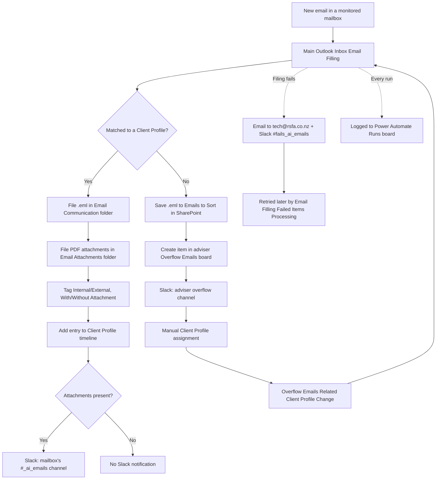

# Outlook Email Filing to SharePoint — How It Works

## About this guide

This is a plain-language, step-by-step walkthrough of how RSFA's Outlook Email Filing automation works today, written for RSFA staff rather than for a technical audit.

For the full technical record — exact Power Automate flow names, workflow IDs, evidence sources and open verification items — see the canonical document: `knowledge/automations/power-automate/AUTO-EMAIL-001-client-email-filing.md`.

**This guide replaces the previous version of this document.** The previous version only described the Sent-folder path for a single mailbox, with no detail on the overflow queue, forced-match convention, error handling or run logging. Its screenshots (hosted on GetGuru) no longer matched the current flow and have been removed. Every step below has a placeholder for a new screenshot — see [How to fill in the screenshots](#how-to-fill-in-the-screenshots) at the end.

**Last updated:** 2026-08-04. Content reflects the 2026-07-30 Power Automate Solution export plus adjustments RSFA reported on 2026-08-04 (see the callouts marked **(2026-08-04)** below — these are not yet independently re-verified against a live export).

---

## 1. Overview

The automation watches several Outlook mailboxes. When a new email arrives, it tries to match the sender/recipient to a Client Profile in Monday.com and file a copy of the email — and any PDF attachments — into that client's SharePoint folder. If it can't find a confident match, the email goes into a human-reviewed overflow queue instead of being dropped or lost. If the filing attempt itself fails, the automation now flags that failure to the team rather than failing silently.




---

## 2. Which mailboxes are covered

| Mailbox | Sent folder | Received folder | Status |
|---|---|---|---|
| Rod | Monitored | Monitored | Active |
| Kathleen | Monitored | Monitored | Active |
| Seth | Monitored | Monitored | Active |
| Jet | Monitored | Monitored | Active — planned retirement (removed when Jet leaves RSFA) |
| Support (shared) | Monitored | Monitored | Active |
| IT Support (shared) | Monitored | Monitored | **Active — added 2026-08-04** (per RSFA report; exact flow name not yet confirmed in an export) |
| Leo | — | — | Planned, not active yet |

Every mailbox-specific flow calls one shared, central flow — **Main Outlook Inbox Email Filling** — which does the actual matching, filing, tagging and notification work described below. This means a fix or change made once in the central flow applies to every mailbox.


---

## 3. Step-by-step: how an email gets filed

### 3.1 Detecting the email

1. **New email detected.** The automation watches the Sent and Received folders of each monitored mailbox for new messages.

   

2. **Short delay.** A small delay runs after detection so that multiple instances of the automation don't overlap and cause conflicts.

   

### 3.2 Reading the email

3. **Extract email details.** Sender address, To/CC/BCC recipients, subject and timestamp are pulled from the message.

   

4. **Convert and format the timestamp** to the correct time zone and a consistent date/time format.

   

5. **Get and combine To recipients** into a single organized list.

   

6. **Get and combine CC recipients** into a single list.

   

7. **Get and combine BCC recipients** into a single list (handled separately since BCC recipients aren't visible to others on the email).

   

8. **Clean up the sender's name**, removing extra characters or formatting.

   

9. **Combine all recipients** (To, CC, BCC) into one combined string for reference.

   

10. **Clean up the subject line**, removing extra characters or formatting.

    

### 3.3 Matching the email to a client

11. **Search the Contacts board's primary email column** for a record matching the sender or recipient address.

    

12. **Check whether a match was found.** If yes, continue normally. If not, the automation runs an alternate search (next step).

    

13. **Alternate search in the secondary/alternate email column** on the Contacts board, if the primary search didn't find anything.

    

14. **Forced match via subject line (Real Savvy Ref).** Independently of address matching, an adviser can use the Real Savvy Ref Outlook Add-in to put `RSFA Ref %ClientProfileID%` in the email subject, forcing a match to a specific Client Profile regardless of the sender/recipient address.

    

15. **Parse the matched Client Profile's unique ID**, once a match is found by any of the methods above.

    

16. **Query the Client Profile record** for its linked SharePoint folder.

    

### 3.4 Filing the email

17. **Locate the client's folder in SharePoint** using the folder link from the Client Profile record.

    

18. **Check whether the email file already exists** in SharePoint, to avoid creating a duplicate.

    

19. **If the file already exists, stop here** — nothing further happens for that email.

    

20. **Save the email file.** If the client's folder exists, the `.eml` file is saved under `f. Email Communication` inside it. If the client folder can't be found, the email is instead saved to a general/overflow SharePoint location (historically `Emails to sort/Rod_Shay_Kathleen` — TODO: confirm this path is still current for every mailbox).

    

21. **Classify Internal vs. External**, by checking whether the sender and recipient(s) both use the RSFA domain.

    

22. **Check for PDF attachments.**

    

23. **Tag the email file's properties** in SharePoint with one of four combinations:
    - Internal, No Attachment
    - Internal, Yes Attachment
    - External, No Attachment
    - External, Yes Attachment

    

24. **Save each PDF attachment** as its own file under `g. Email Attachments` in the client's folder, and tag its properties the same way.

    

25. **Add an entry to the Client Profile's Emails & Activities timeline** so the correspondence shows up on the client record in Monday.com.

    

26. **Send a Slack notification if an attachment was filed.** The message goes to that mailbox's own Slack channel, following the pattern `{mailbox}_ai_emails` — for example `rod_ai_emails`, `kathleen_ai_emails`, `seth_ai_emails`, `jet_ai_emails`. **(2026-08-04)** RSFA reports `it_support_ai_emails` and `support_ai_emails` channels were added, extending this to the IT Support and Support mailboxes — not yet independently confirmed in an export.

    

27. **Log the run.** **(2026-08-04)** Every run of this flow is now recorded as an item on the Monday.com `Power Automate Runs` board — see [§6](#6-tracking-every-run--power-automate-runs-board-2026-08-04) below.

    

---

## 4. When a match can't be found — the overflow path

If no Client Profile can be matched (address search and Real Savvy Ref both come up empty):

1. The `.eml` file is saved to a general **Emails to Sort** location in SharePoint instead of a client folder.
2. An item is created on the relevant adviser's **Overflow Emails** board (Rod/Kathleen, Seth, or Jet — see the boards table below).
3. A Slack message is sent to that adviser's overflow Slack channel.
4. An AI-suggested Client Profile match may be proposed (**Overflow Emails Contact Matching**), which requires human approval before being applied (**Overflow Emails Suggested Match Approval**) — it is not applied automatically.
5. Once a person manually assigns a Client Profile to the overflow item (either accepting the AI suggestion or picking one directly), that assignment triggers **Overflow Emails Related Client Profile Change**, which reprocesses the email through the same filing logic described in [§3.3](#33-matching-the-email-to-a-client) onward.


**Overflow boards:**

| Board | Adviser(s) | Status |
|---|---|---|
| 📬 Overflow Emails - Rod/Kathleen | Rod, Kathleen | Active |
| 📬 Overflow Emails - Seth | Seth | Active |
| 📬 Overflow Emails - Jet | Jet | Active — planned retirement |
| 📬 Overflow Emails (OLD) | — | Legacy — TODO: confirm current use |

---

## 5. When something fails — error handling **(2026-08-04)**

If a filing attempt itself fails (as opposed to simply not finding a client match, which is the overflow path above):

1. An email is sent to `tech@rsfa.co.nz` with the subject **Failed Item Email Filing**, so the item can be picked up and reprocessed later by the scheduled `Email Filling Failed Items Processing` flow (part of the Email Backup and Failed Item Recovery automation).
2. A Slack notification is also posted to the shared `fails_ai_emails` channel, so the whole team has visibility into filing failures, not just the technical inbox.


> **Note:** the Slack side of this may not be brand new as of 2026-08-04 — a Power Automate export inspected on 2026-07-30 already showed the `fails_ai_emails` Slack channel wired in alongside `tech@rsfa.co.nz` in the failure-notification step. It's possible this was already in place and simply hadn't been documented yet, rather than being a change made on 2026-08-04. Not yet confirmed either way.

---

## 6. Tracking every run — Power Automate Runs board **(2026-08-04)**

Power Automate's own run history only keeps 28 days of data, which isn't enough for long-term tracking or troubleshooting. To fix this, RSFA reports a new Monday.com board was created:

**Power Automate Runs** — [https://rsfa-squad.monday.com/boards/5030408927](https://rsfa-squad.monday.com/boards/5030408927)

Every execution of a connected flow gets one item on this board, with the following columns:

| Column | Purpose |
|---|---|
| Solution | Which Power Automate Solution the flow belongs to |
| Flow Name | Exact name of the flow that ran |
| Power Automate Run URL | Direct link to that run in the Power Automate portal |
| Status | `Succeeded`, `Cancelled`, `Failed`, or `Running` |
| Started At | When the run began |
| Finished At | When the run ended |
| Processing Details | A JSON blob with the specific details of that run |
| Parent Runs | For subflows (like `Main Outlook Inbox Email Filling`, which is called by every mailbox-specific flow), a link back to the parent flow's run item |

At the moment, only the Email Filing flow family is connected to this board. RSFA plans to connect other Power Automate flows to it over time, so it becomes a single place to check the history of any flow's runs — not just email filing.


---

## 7. What's still unclear or unverified

This section is intentionally honest about gaps, so nobody assumes something is confirmed when it isn't:

- The exact new Power Automate flow name(s) for the IT Support mailbox haven't been confirmed yet.
- Whether the `fails_ai_emails` Slack notification is genuinely new as of 2026-08-04, or simply undocumented until now (see the note in §5).
- Which flows are and aren't yet connected to the Power Automate Runs board, beyond Email Filing.
- Whether the Power Automate Runs board's `Processing Details` field records which specific email was filed against which Client Profile, or only flow-level run status.
- Whether the general "Emails to Sort" SharePoint path referenced in [§3.4](#34-filing-the-email) is still current for every mailbox.
- Exact retry schedule for `Email Filling Failed Items Processing`.

See `knowledge/automations/power-automate/AUTO-EMAIL-001-client-email-filing.md` §25 for the full, continuously-updated list.

---

## 8. Where to go for more detail

- **Full technical record** (flow names, workflow IDs, export evidence, registry entries): `knowledge/automations/power-automate/AUTO-EMAIL-001-client-email-filing.md`
- **Monday board registry:** `knowledge/04_MONDAY_BOARDS_REGISTRY.md`
- **Automation registry:** `knowledge/03_AUTOMATION_REGISTRY.md`
- **System-wide email flow diagram:** `knowledge/01_RSFA_SYSTEM_MAP.md` §10

---

## How to fill in the screenshots

Every step above has a placeholder in this form:

```markdown

```

To add a real screenshot, replace `PENDING` with the image's URL or a relative path to an image file stored in this repository (e.g. under an `assets/` folder next to this document), keeping the descriptive alt text so the image stays identifiable if the link ever breaks again.

---

## Change history

| Date | Change | Author |
|---|---|---|
| 2026-08-04 | Full rewrite from the original GetGuru-sourced walkthrough (Sent-folder-only, single mailbox, no overflow/error/logging detail, dead image links). Now covers all monitored mailboxes, the forced-match convention, the overflow path, error handling and the Power Automate Runs board. Screenshots removed pending replacements — see placeholders throughout. | Claude (documentation task) |
